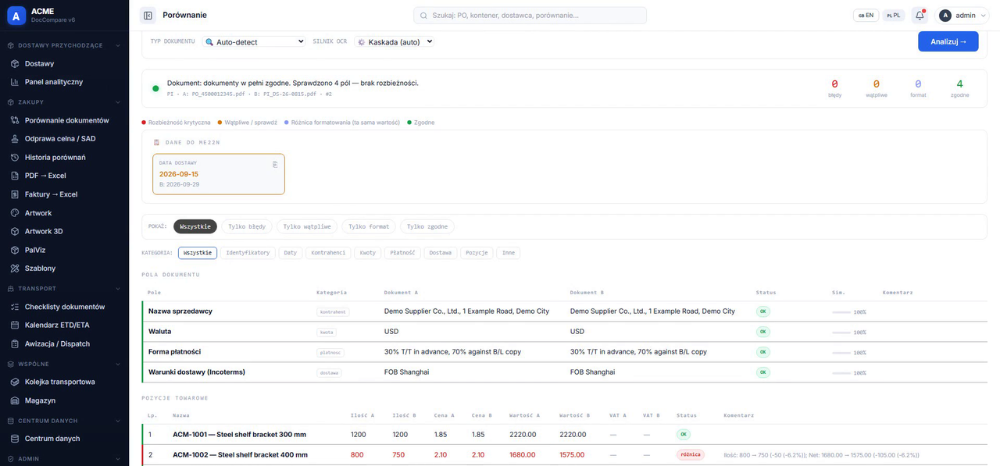

# DocCompare

[](https://github.com/TomaszWu14/doc.compare-public/actions/workflows/ci.yml)

**Porównuje dokumenty importowe (zamówienie, proformę, fakturę, listę pakową, zgłoszenie celne) linia po linii i zatrzymuje dostawę, zanim rozbieżność ilości lub ceny dotrze do odprawy — dla działów zakupów i logistyki.**



🎞️ GIF z działania: `<DO UZUPEŁNIENIA: docs/screenshots/demo.gif — nagram>`

📹 Prezentacja działania — 2 min: `<DO UZUPEŁNIENIA: link YouTube>`

🌐 Demo: brak publicznej instancji — `<DO UZUPEŁNIENIA: jedno zdanie, dlaczego>`. Aplikację uruchomisz lokalnie w kilka minut ([niżej](#jak-uruchomić)).

> **Projekt portfolio.** Nazwy firm są zastąpione fikcyjnymi (ACME), dane demo i testowe są syntetyczne.

## Problem → rozwiązanie

Jedna dostawa importowa to kilka dokumentów od różnych stron, każdy w innym układzie. Zespół
sprawdzał je ręcznie, a stan dostaw żył w Excelu i w mailach, więc błąd w ilości lub cenie wychodził
dopiero przy odprawie albo rozliczeniu. DocCompare czyta tabele z PDF, dopasowuje pozycje mimo różnych
zapisów kodów i porównuje je z tolerancjami z profilu dostawcy. Wynik trafia na kartę dostawy:
niezgodność blokuje kolejny krok, a przed odprawą aplikacja wymaga zatwierdzonego kompletu dokumentów.

## Dokumentacja analityczna

| Dokument | Co zawiera |
|---|---|
| [01 — Problem i zakres](docs/01-problem-i-zakres.md) | Jak proces wyglądał przed aplikacją, interesariusze i role, co jest w zakresie, a co poza nim. |
| [02 — Proces](docs/02-proces.md) | Proces PRZED i PO z diagramami, aktorzy, punkty decyzyjne z warunkami z kodu, maszyna stanów dostawy. |
| [03 — User flow](docs/03-user-flow.md) | Mapa 75 ekranów i przejść: diagramy per obszar, tabela ekranów, ścieżki alternatywne i ślepe zaułki. |
| [04 — Model danych](docs/04-model-danych.md) | ERD, opis encji, reguły integralności i miejsca, gdzie model nie trzyma ograniczeń. |
| [05 — Wymagania](docs/05-wymagania.md) | Wymagania z kryteriami akceptacji i wskazaniem, gdzie są zrealizowane i przetestowane. |
| [06 — Decyzje](docs/06-decyzje.md) | Dziennik 12 decyzji: kontekst, rozważane opcje, uzasadnienie, skutki. |
| [07 — Ograniczenia](docs/07-ograniczenia.md) | Czego aplikacja nie robi, funkcje opisane, ale niezaimplementowane, znane problemy, co dalej. |

Starsze dokumenty w `docs/` (runbook IT, backup, kolejkowanie, plan refaktoru) opisują stronę techniczną.
`PROCES_ZAKUPY_FLOW.md` i `PROCES_POTWIERDZENIE_ETD.md` to proces docelowy — stan obecny opisują 02 i 07.

## Jak uruchomić

Pełne `requirements.txt` instaluje stos ML/OCR (PyTorch, DocTR…) — kilka GB. Do testów i głównej
logiki porównania wystarczy lekki zestaw, ten sam co w CI (Python 3.11+):

```bash
python -m venv .venv
source .venv/bin/activate            # Windows: .venv\Scripts\activate
pip install pytest python-dateutil dateparser babel flask werkzeug pydantic pypdf \
            reportlab pdfplumber rapidfuzz numpy "pandas>=2.0"

python -m pytest tests/ -q           # ~600 testów; te, które wymagają ciężkich zależności, są pomijane
python migrate_db.py                 # schemat bazy (SQLite w instance/) — bez tego część ekranów zwraca 500
python app.py                        # http://localhost:5000
```

Bez pliku `.env` aplikacja startuje na SQLite. Przy pierwszym starcie tworzy konta `admin`, `superuser`,
`jan.kowalski` i `anna.nowak` z **losowymi hasłami**. Hasło admina jest wypisywane w konsoli i zapisywane
w `INITIAL_ADMIN_PASSWORD.txt` (plik w `.gitignore`); hasła pozostałych kont ustawia admin.
Funkcje OCR, ML i walidacja AI wymagają pełnego `requirements.txt` oraz kluczy z `.env.example`.

## Stack i dlaczego taki

| Element | Dlaczego |
|---|---|
| **Python + Flask** | Narzędzie wewnętrzne oparte na dokumentach: strony renderowane po stronie serwera, bez osobnego builda front-endu. Moduły wydzielane stopniowo do blueprintów ([D-05](docs/06-decyzje.md)). |
| **pdfplumber / PyMuPDF / Camelot + OCR (Mistral, RapidOCR, Tesseract)** | Żadna pojedyncza biblioteka nie radzi sobie z układem każdego dostawcy, więc ekstrakcja to kaskada: tańsze metody najpierw, OCR tylko dla skanów ([D-03](docs/06-decyzje.md)). |
| **rapidfuzz + TF-IDF** | Dostawcy zapisują te same kody inaczej (`NL753-S-40` ≈ `NL753S40`); dopasowanie rozmyte zamiast porównania tekstów. |
| **Reguły deterministyczne + opcjonalnie API Claude** | O zgodności decydują reguły i tolerancje z profilu dostawcy; AI ocenia ryzyko na gotowym wyniku, a jej sugestie czekają na akceptację managera. Aplikacja działa bez klucza API ([D-01](docs/06-decyzje.md)). |
| **SQLite (dev) / PostgreSQL (prod) przez `db.py`** | Jedna warstwa tłumaczy dialekty SQL, więc lokalnie nie trzeba stawiać serwera bazy ([D-04](docs/06-decyzje.md)). |
| **Wątki + RQ/Redis z fallbackiem** | Ciężkie zadania (paczki artworków, ekstrakcja) nie blokują żądania HTTP; bez Redisa działają w wątkach ([D-06](docs/06-decyzje.md)). |
| **Docker + gunicorn** | Oryginał był wdrażany jako kontener na Coolify / Hetzner; ta kopia portfolio nie ma workflow wdrożenia. |
| **Alpine.js, Tailwind, Chart.js** | Interaktywność w szablonach Jinja bez frameworka SPA. |
| **pytest + GitHub Actions** | ~600 testów czystej logiki uruchamianych w CI w kilkadziesiąt sekund; ciężkie importy ML są leniwe ([D-11](docs/06-decyzje.md)). |

## Zakres i ograniczenia

- **W zakresie:** porównanie PO/PI/CI/PL/SAD, karta dostawy z bramkami, checklista celna, portale
  spedytora i agencji celnej, porównanie artworków z walidacją EAN/GS1, Faktury → Excel, ocena ryzyka AI.
- **Poza zakresem:** integracja z SAP (wzorcem jest PDF zamówienia), automatyczne alerty e-mail,
  portal potwierdzeń ETD dla dostawcy. Pełna lista z powodami: [01](docs/01-problem-i-zakres.md#5-poza-zakresem-nie-zaimplementowane).
- **Znane problemy** (np. przyjęcie magazynowe nie tworzy się automatycznie, ceny porównywane bez
  waluty) i ograniczenia techniczne (`app.py` ~20 tys. linii, ciężkie zależności ML):
  [07 — Ograniczenia](docs/07-ograniczenia.md).

## Kod — od czego zacząć

- [`enhanced_comparator.py`](enhanced_comparator.py) — rozbiór tabel na pozycje i porównanie z tolerancjami.
- [`delivery_workflow.py`](delivery_workflow.py) — kroki karty dostawy, statusy, SLA.
- [`pdf_extractor.py`](pdf_extractor.py) — kaskada ekstrakcji tekstu i tabel.
- [`invoice_pipeline.py`](invoice_pipeline.py) — jedna faktura od profilu dostawcy do zapisanych pozycji.

Historia commitów została spłaszczona przy przygotowaniu wersji portfolio (anonimizacja).

## Kontekst projektu

`<DO UZUPEŁNIENIA: w jakiej roli i dla kogo powstał projekt, okres, ilu użytkowników>`

**Mój wkład.** Jestem jedynym autorem: analiza procesu z działami zakupów i logistyki, model danych,
kaskada ekstrakcji, silnik porównania, interfejs, testy i wdrożenie. Skala: ~600 testów, ~410 tras
Flask obejmujących zakupy → transport → cło → rozliczenie.

---

Licencja: wszelkie prawa zastrzeżone, kod udostępniony do wglądu — [`LICENSE`](LICENSE).
Notatki dla deweloperów i agentów AI: [`CLAUDE.md`](CLAUDE.md), [`AGENTS.md`](AGENTS.md).
