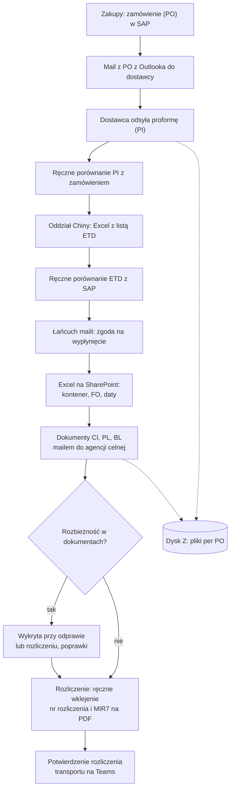
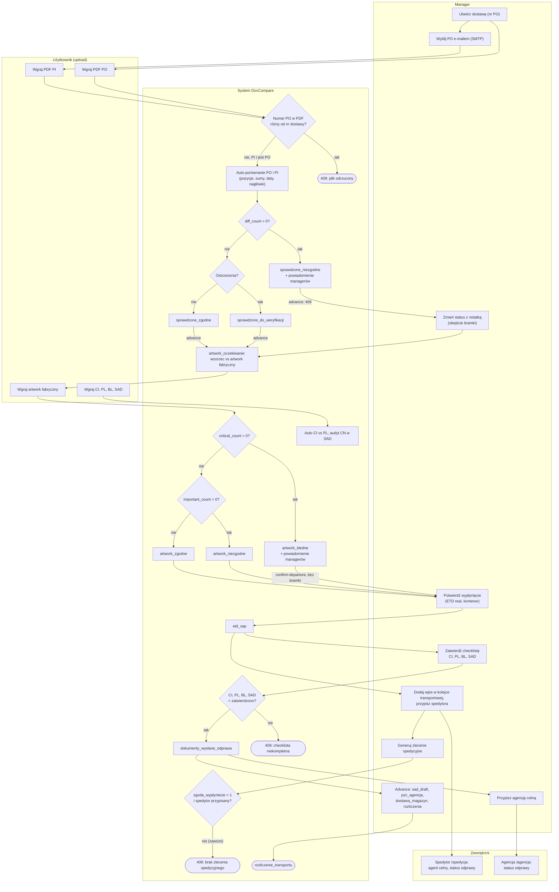
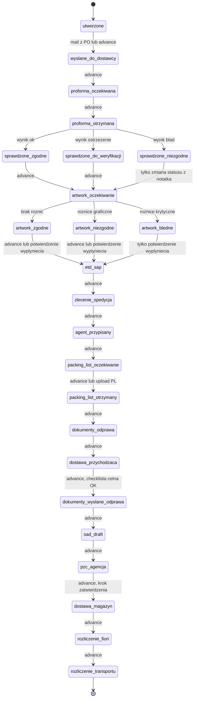

# 02. Proces

> Proces zakupy → transport → odprawa → rozliczenie, opisany według tego, co robi kod.
> Rekord procesu to wiersz `kolejka_zlecenia` (klucz: numer PO), ekran `/dostawy`.
> Dokumenty: `shipment_documents` (sloty PO, PI, CI, PL, BL, ARTWORK, ARTWORK_B, SAD). Log zmian: `kolejka_status_log`.

## 1. Aktorzy

| Aktor | Typ | Udział w procesie |
|---|---|---|
| Manager (`manager` i wyżej) | człowiek, wewnętrzny | tworzy dostawę, wysyła PO, przesuwa statusy, uruchamia weryfikacje, potwierdza wypłynięcie, zatwierdza checklistę celną, przypisuje spedytora i agencję |
| Użytkownik (`user`) | człowiek, wewnętrzny | wgrywa dokumenty do dostawy; moduł Faktury → Excel / Draft SAD |
| Spedytor (`forwarder`) | człowiek, zewnętrzny | portal `/spedycja`: agent celny i status odprawy dla swoich wierszy kolejki |
| Agencja celna (`customs_agent`) | człowiek, zewnętrzny | portal `/agencja`: status odprawy dla swoich wierszy kolejki |
| Dostawca | zewnętrzny, poza systemem | dostaje PO mailem; jego dokumenty wgrywa użytkownik |
| System DocCompare | system | walidacja numeru w PDF, auto-porównania, audyt CN, statusy automatyczne, powiadomienia |
| SMTP, tracking kontenerów, Claude API | systemy zewnętrzne | mail z PO i powiadomienia; ETA kontenera; opcjonalna ocena ryzyka |

## 2. Proces PRZED (bez aplikacji)

> **Zrekonstruowany z dokumentów** (`docs/PROCES_ZAKUPY_FLOW.md`, `README.md`), nie z obserwacji.
> Kolejność kroków przyjęta za numeracją kroków w `PROCES_ZAKUPY_FLOW.md`.
> Czasy trwania: `<DO UZUPEŁNIENIA: czas trwania kroków procesu PRZED>`.

## 3. Proces PO z aplikacją (as-is)

Warunki w rombach są przepisane z kodu (sekcja 4 podaje miejsca).

Uwagi do diagramu:
- Advance prowadzi przez wszystkie kroki stepera pojedynczo (`etd_sap` → `zlecenie_spedycja` → … → `dostawa_przychodzaca` → `dokumenty_wyslane_odprawa`); diagram skraca je do kroków z decyzją.
- Gałąź „PI bez PO” (`proforma_zaladowana`) i jej obejście weryfikacji są w sekcji 7.

## 4. Punkty decyzyjne

| Decyzja | Warunek | Skutek | Gdzie w kodzie |
|---|---|---|---|
| Format numeru PO | numer pasuje do `^[45]\d{8,10}$`; numer nie istnieje | inaczej 400; duplikat 409 | `app.py:18574`, `app.py:18581-18584` |
| Numer w wgranym PDF | PDF typu PO/PI/CI/PL/SAD zawiera numer PO różny od numeru dostawy | plik usunięty, 409; brak numeru w PDF przepuszcza | `app.py:18372-18389` |
| Wysyłka PO | jest dostawca z adresem e-mail; SMTP działa | brak dostawcy lub e-maila 400; błąd SMTP 502; sukces → `wyslane_do_dostawcy` | `app.py:18732-18762` |
| Upload PI | dostawa ma już PO | tak → auto-porównanie PO↔PI w tle; nie → `proforma_zaladowana` (tylko z wczesnych statusów) | `app.py:18422-18428`, `delivery_workflow.py:380-384` |
| Wynik PO↔PI | `diff_count > 0` → `blad`; ostrzeżenia sum, dat, nagłówków lub `warn_count` → `ostrzezenie`; inaczej `ok` | `sprawdzone_niezgodne` (+ powiadomienie) / `sprawdzone_do_weryfikacji` / `sprawdzone_zgodne` | `app.py:19386-19395`, `delivery_workflow.py:370-377`, `app.py:19462-19468` |
| Twarda bramka wyniku | bieżący status ∈ {`sprawdzone_niezgodne`, `artwork_bledne`} | advance 409 | `app.py:64`, `app.py:18792-18798` |
| Obejście bramki wyniku | zmiana statusu z negatywnego wyniku | bez notatki 400, z notatką dowolny status | `app.py:18974-18980` |
| Upload artworku fabrycznego | wzorzec (ARTWORK) jest podpięty | tak → auto-weryfikacja w tle; nie → `artwork_oczekiwanie` | `app.py:18430-18436` |
| Wynik artworku | `critical_count > 0` (EAN, LOT, data, REF, MDR); `important_count > 0` (grafika, kolor, wymiar) | `artwork_bledne` (+ powiadomienie) / `artwork_niezgodne` / `artwork_zgodne` | `app.py:19557-19574` |
| Miękka bramka dokumentów | dla statusu docelowego brak dokumentów z `REQUIRED_DOCS` (np. `sad_draft` wymaga SAD) | pytanie o potwierdzenie; `confirm=true` przepuszcza | `delivery_workflow.py:305-311`, `app.py:18825-18835` |
| Bramka celna | wejście w `dokumenty_wyslane_odprawa`; każdy z CI, PL, BL, SAD ma w checkliście dokładnie `zatwierdzono` | inaczej 409; `confirm=true` nie przepuszcza | `customs_checklist.py:15-28`, `app.py:18810-18822` |
| Potwierdzenie wypłynięcia | `etd_real` podane; status ∈ {`artwork_oczekiwanie`, `zatwierdzone_do_wyplyniecia`, `artwork_zgodne`, `artwork_niezgodne`, `artwork_bledne`} | brak ETD 400; status → `etd_sap` | `app.py:20245-20246`, `app.py:20282-20292` |
| Zlecenie spedycyjne | `zgoda_wyplyniecie == 1` i przypisany spedytor | inaczej 409 | `forwarding_order.py:29-41`, `blueprints/kolejka.py:143-149` |
| Krok zatwierdzenia | następny status = `dostawa_magazyn` | wymaga roli manager/superuser/admin | `delivery_workflow.py:269`, `app.py:18805` |
| Audyt CN | jedna strona porównania to SAD | kod niezgodny → błąd; brak kodu w SAD lub masterze → uwaga; zgodne ≥ 8 pierwszych cyfr → ok | `cn_audit.py:122-154` |
| Faktury → Draft SAD | profil dostawcy istnieje; brak pozycji `ambiguous`; wszystkie CI/proformy batcha zatwierdzone | brak profilu → job `error`; `ambiguous` blokuje zatwierdzenie; Draft SAD 409 | `invoice_pipeline.py:73`, `invoice_mapper.py:73-75`, `invoice_routes.py:247-256` |

## 5. Maszyna stanów dostawy (ścieżka główna)

Pominięto: statusy legacy, automatyczne ładowanie wzorca artworku (`artwork_master_zaladowany`, `artwork_brak_mastera`, `artwork_czeka_fabryczny`), cofanie (`revert`) i ręczną zmianę statusu, która pozwala przejść z dowolnego statusu do dowolnego.

Źródło przejść: `delivery_workflow.py:38-82` (kolejność kroków) i `delivery_workflow.py:203-232` (`NEXT_STATUS`).

## 6. Wejścia i wyjścia per krok

| Krok | Wejście | Wyjście | Kto |
|---|---|---|---|
| Utworzenie dostawy | nr PO, dostawca, priorytet, przeznaczenie | `kolejka_zlecenia` (`utworzone`), checklista 6 dokumentów ze statusem `brak` | manager |
| Upload PO | PDF PO | dokument PO, dane z PDF dopisane do dostawy, podpięty wzorzec artworku (bez zmiany statusu) | user / manager |
| Wysyłka PO | e-mail dostawcy z master danych | mail SMTP, status `wyslane_do_dostawcy` | manager |
| Upload PI + weryfikacja PO↔PI | PDF PO i PDF PI, profil dostawcy, `material_master` | rekord `comparisons`, raport PDF `RAPORT_PO_PI`, status wyniku, powiadomienie przy niezgodności | user / manager + system |
| Weryfikacja artworku | wzorzec z biblioteki (ARTWORK), artwork fabryczny (ARTWORK_B) | wynik porównania, raport, status `artwork_*`, powiadomienie przy błędach krytycznych | user / manager + system |
| Potwierdzenie wypłynięcia | `etd_real`, opcjonalnie nr kontenera i plomby | `kolejka_kontenery.departure_confirmed=1`, status `etd_sap` | manager |
| Kolejka transportowa | kontener, spedytor, agencja | wiersz `transport_queue` widoczny w portalu spedytora / agencji; tracking i ETA | manager |
| Zlecenie spedycyjne | dostawa ze zgodą na wypłynięcie i spedytorem | dokument `ZS` + wiersz `transport_queue` (w praktyce 409, patrz sekcja 7) | manager |
| Upload CI / PL / BL / SAD | PDF-y | dokumenty; auto-porównanie CI↔PL; PL przesuwa do `packing_list_otrzymany` | user / manager + system |
| Checklista celna | ręczne statusy CI, PL, BL, SAD | odblokowanie `dokumenty_wyslane_odprawa` | manager |
| Zestaw celny | najnowsze CI, PL, BL, SAD | jeden PDF `SET` | manager |
| Odprawa w portalach | wiersz `transport_queue` | `customs_status` ∈ {oczekuje, w_odprawie, zatwierdzone, odrzucone, wydane} | spedytor / agencja / manager |
| Faktury → Excel / Draft SAD | PDF-y CIPL, profile dostawców, master data | Excel zbiorczy, Excel Draft SAD (wysyłany do agencji ręcznie) | user |
| Magazyn i rozliczenie | brak danych wejściowych w kodzie (tylko advance) | statusy `dostawa_magazyn`, `rozliczenie_fiori`, `rozliczenie_transportu` | manager |

## 7. Znane rozbieżności procesu (obserwacje)

1. **Advance z proformy pomija weryfikację PO↔PI.** `NEXT_STATUS` dla `proforma_otrzymana` i `proforma_zaladowana` to `artwork_oczekiwanie` (`delivery_workflow.py:207-208`). Manager może przejść dalej bez porównania; bramka wyniku nie zadziała, bo wyniku nie ma.
2. **Potwierdzenie wypłynięcia omija bramkę artworku.** `confirm-departure` przenosi z `artwork_bledne` do `etd_sap` (`app.py:20282-20292`), choć advance z tego statusu daje 409.
3. **Ręczna zmiana statusu omija bramkę celną.** `set-status` sprawdza tylko notatkę i miękką bramkę dokumentów (`app.py:18966-18995`); nie sprawdza checklisty CI, PL, BL, SAD.
4. **Przyjęcie magazynowe nigdy nie powstaje automatycznie.** Hook jest tylko w `_set_dostawa_status` (`app.py:17575-17576`), a status magazynowy ustawiają `advance` i `set-status` własnym `UPDATE`. Żadne wywołanie `_set_dostawa_status` nie ustawia statusu magazynowego. Ręczne utworzenie przyjęcia zwraca 405 (`blueprints/warehouse.py:205-216`).
5. **Dostawa nie trafia sama do kolejki transportowej.** Ten sam mechanizm dla `etd_sap` (`app.py:17572-17573`); `confirm-departure` i `advance` go omijają. Wiersz kolejki tworzy ręcznie manager (`POST /api/transport/queue`, `app.py:16384`).
6. **Zlecenie spedycyjne zawsze kończy się 409.** Warunek wymaga `zgoda_wyplyniecie == 1`, a żaden kod w aplikacji tej kolumny nie ustawia (grep `zgoda_wyplyniecie` w `*.py`: tylko odczyt i schemat).
7. **Alerty e-mail z `alert_engine` nie są wywoływane.** Reguły (różnica ilości > 5%, zamiana I↔1) istnieją w `alert_engine.py`, ale moduł nie jest nigdzie importowany. Działają tylko `_notify_managers` (niezgodność PO↔PI, błędy artworku) i alert Resend przy statusie `critical`.
8. **Status odprawy nie łączy się ze statusem dostawy.** `customs_status` w portalach można ustawić na dowolną wartość ze zbioru, bez reguł przejść, i nie zmienia on `kolejka_zlecenia.status` (`sad_draft`, `pzc_agencja` przesuwa tylko manager).
9. **Checklista celna jest w pełni ręczna.** Upload dokumentu nie zmienia jej statusu na `wgrano`.
10. **Wejście na kartę dostawy zmienia status.** `GET /dostawy/<nr>` może ustawić status przez automatyczne ładowanie wzorca artworku (`app.py:18079-18109`).
11. **Krok zatwierdzenia magazynu nie różni się od zwykłego advance.** Advance i tak wymaga roli `manager` (`app.py:18770`), więc sprawdzenie roli dla `dostawa_magazyn` niczego nie dodaje.
12. **Status `zatwierdzone_do_wyplyniecia` jest nieosiągalny** poza ręczną zmianą statusu; ma przejście dalej, ale żaden kod go nie ustawia.
13. **Zatwierdzenie porównania SAD zmienia starą tabelę.** Ustawia `shipments.status='odprawa'` (`app.py:3545-3556`), a nie status w `kolejka_zlecenia`.
14. **SLA tylko oznacza.** Limity dni w statusie (`delivery_workflow.py:405-427`) wyświetlają się na liście `/dostawy`, bez powiadomień i eskalacji.

Czy pozycje 1–6 to zamierzone zachowanie, czy błędy: `<DO UZUPEŁNIENIA: decyzja właściciela procesu dla każdej z obserwacji 1–6>`.
