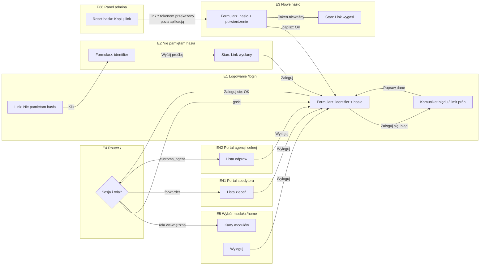
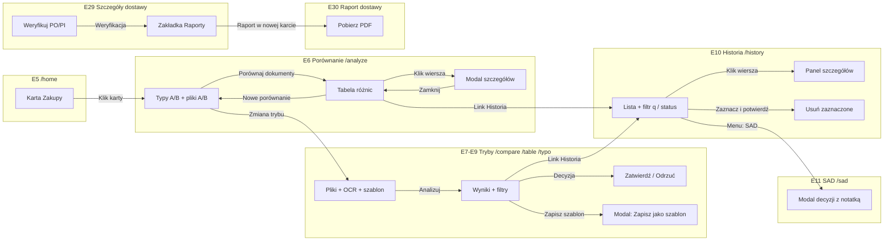
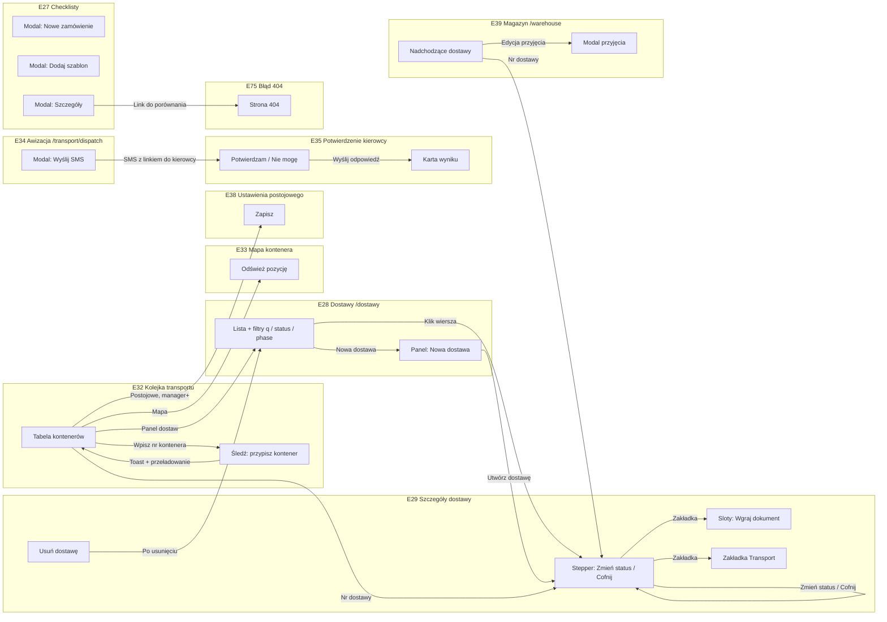
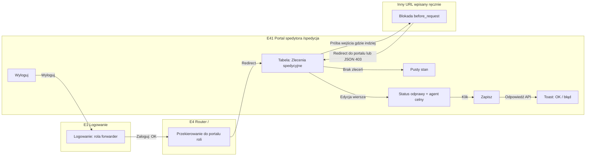
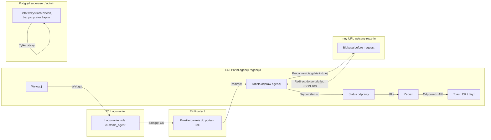
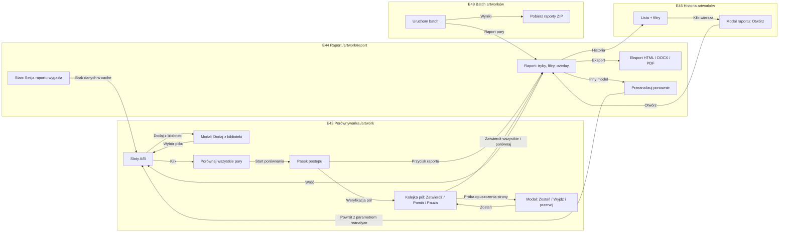

# 03. User flow — mapa ekranów i przejść

Dokument opisuje, jak użytkownik porusza się po aplikacji DocCompare: jakie ekrany istnieją, co na nich jest, jaka akcja prowadzi dokąd. Opis powstał z analizy kodu (trasy w `app.py`, `blueprints/`, `invoice_routes.py` i szablony w `templates/`). Odwołania mają postać `plik:linia`.

## 1. Jak czytać

- **Nr ekranu** (1–75) jest stały w całym dokumencie: w diagramach, tabeli i uwagach.
- **Rola** oznacza minimalne uprawnienie potrzebne do wejścia:
  - `gość` — bez logowania,
  - `login` — każdy zalogowany użytkownik wewnętrzny (`@login_required`, core/security.py:83),
  - `user` / `≥manager` / `admin` — `@require_role(...)` (core/security.py:95) albo sprawdzenie roli w kodzie widoku,
  - `forwarder`, `customs_agent` — role zewnętrzne, zamknięte w swoich portalach (patrz sekcja 5).
- Hierarchia ról wewnętrznych: `user < manager < superuser < admin`.
- **in-page** — wynik akcji pojawia się na tym samym ekranie (fetch + odświeżenie fragmentu), bez przejścia na inny URL.
- Ekrany oznaczone „bez base” nie mają bocznego menu (nie dziedziczą `templates/base.html`).

## 2. Mapa nawigacji (menu boczne)

Menu pochodzi z `templates/base.html:84-310`. Sekcje i pozycje:

| Sekcja menu | Pozycje (URL) | Widoczność |
|---|---|---|
| Dostawy przychodzące | `/dostawy`, `/dostawy/analityka` | wszyscy zalogowani |
| Zakupy | `/analyze`, `/sad`, `/history`, `/scan`, `/invoices/`, `/artwork`, `/artwork/3d`, `/artwork/palviz`, `/artwork/templates` | wszyscy zalogowani |
| Transport | `/checklists`, `/calendar`, `/transport/dispatch` | wszyscy zalogowani |
| Wspólne | `/transport/queue`, `/warehouse` | wszyscy zalogowani |
| Centrum danych | `/data` (kafle do słowników i master data) | wszyscy zalogowani |
| Admin | `/kpi`; `/admin` tylko dla roli `admin` | `manager`, `superuser`, `admin` (base.html:249, 265) |
| Stopka menu | `/tickets`, `/help`, `/logout`, `/profile` | wszyscy zalogowani |

Elementy globalne nagłówka: wyszukiwarka → `/search` (base.html:335), przełącznik PL/EN → `/set-language/<lang>` (base.html:347-353), panel powiadomień (`notifPanel`, base.html:386), globalny modal potwierdzenia `confirmOverlay` (base.html:397), overlay serwisowy sterowany pingiem `/health` (base.html:570-590).

Punkt startowy po zalogowaniu to `/home` (ekran 5, bez menu bocznego) z kartami modułów.

## 3. Diagramy przepływu

### 3.1. Uwierzytelnianie i role

### 3.2. Porównanie dokumentów (Zakupy)

### 3.3. Dostawy, stepper i checklista

### 3.4. Portal spedytora

### 3.5. Portal agencji celnej

### 3.6. Artwork

## 4. Tabela ekranów

### 4.1. Uwierzytelnianie i ekrany wspólne

| Nr | Ekran (URL) | Rola | Elementy | Akcja użytkownika | Prowadzi do |
|---|---|---|---|---|---|
| 1 | Logowanie `/login` (bez base) | gość | `identifier`, `password`, komunikat błędu, link „Nie pamiętam hasła” | Zaloguj się / Nie pamiętam hasła | `/` → `/home` lub portal; `/forgot-password`; ten sam ekran z błędem |
| 2 | Nie pamiętam hasła `/forgot-password` (bez base) | gość | `identifier`, stan „Link wysłany” | Wyślij prośbę o reset / Zaloguj | ten sam ekran (stan); `/login` |
| 3 | Nowe hasło `/reset-password?token=` (bez base) | gość + token | `password`, `confirm`, stany „Link wygasł” / „Hasło zmienione” | Zapisz nowe hasło | `/login`; stan „Link wygasł” |
| 4 | Router `/` | — | brak (tylko przekierowanie, app.py:1616) | automatycznie | `/home`, `/spedycja`, `/agencja`, `/login` |
| 5 | Wybór modułu `/home` (bez base) | login | karty: Zakupy, Transport, Spedycja (manager+), Historia; link „Panel admina” (admin/superuser); Wyloguj | klik karty | `/analyze`, `/transport/queue`, `/spedycja`, `/history`, `/admin`, `/login` |
| 71 | Zgłoszenia `/tickets` | login | formularz (tytuł, opis, kategoria, priorytet), lista ze statusem i odpowiedzią | Wyślij zgłoszenie / Zapisz odpowiedź | in-page |
| 72 | Pomoc `/help` | login | dokumentacja statyczna | link | `/tickets` |
| 73 | Mój profil `/profile` | login | e-mail, telefon, dział; zmiana hasła; język | Zapisz zmiany / Zmień hasło / język | in-page; `/set-language/<lang>` |
| 74 | Wyszukiwarka `/search?q=` | login | pole `q`, wyniki pogrupowane | klik wyniku | `/dostawy/<nr>`, `/transport/queue`, `/suppliers`, `/history?q=` |
| 75 | Błędy 404 / 413 / 429 / 500 | — | komunikat; dla `/api/*` JSON | link | `/`, `/history`; „Wróć” |

### 4.2. Zakupy — porównanie dokumentów, faktury, dostawcy

| Nr | Ekran (URL) | Rola | Elementy | Akcja użytkownika | Prowadzi do |
|---|---|---|---|---|---|
| 6 | Porównanie dokumentów `/analyze` | login | typy A/B, pliki A/B, tabela różnic, modal szczegółów, przełącznik trybów | Porównaj dokumenty / Nowe porównanie / zmiana trybu | in-page; `/compare`, `/table`, `/typo`, `/history`, `/home` |
| 7 | Porównaj dokumenty `/compare` | login | typ, pliki, silnik OCR, szablon, filtry, modal „Zapisz jako szablon” | Analizuj / Zatwierdź / Odrzuć / eksport PDF, Excel | in-page; pobranie pliku; `/history` |
| 8 | Porównanie tabel `/table` | login | pliki, szablon, przełącznik AI, filtry | Analizuj dokumenty | in-page |
| 9 | Literówki `/typo` | login | pliki, szablon, przełącznik AI, filtry I↔1 / O↔0 | Analizuj literówki | in-page |
| 10 | Historia porównań `/history` | login | filtr `q` i `status`, lista z checkboxami, paginacja, panel szczegółów z zakładkami | Szukaj / Usuń zaznaczone / PDF / Excel | `/history?…`; in-page; pobranie |
| 11 | SAD — zatwierdzanie `/sad` | login | lista zgłoszeń, modal decyzji z notatką | Zatwierdź / Odrzuć → Potwierdź | in-page |
| 12 | PDF → Excel `/scan` | login | plik, edytowalna tabela wierszy | Wyciągnij dane (AI) / Dodaj wiersz / Eksport do Excel | in-page; pobranie |
| 13 | Spójność kontenera `/bundle` | login | 4 pliki: B/L, faktura, SAD, faktura transportowa | Sprawdź spójność / Drukuj | in-page |
| 14 | Faktury → Excel `/invoices/` | user | plik PDF, kod dostawcy | Wyślij do przetworzenia | `/invoices/coverage?batch_id=` |
| 15 | Pokrycie dostawców `/invoices/coverage` | user | tabela partii i dostawców | Przejrzyj / Ponów / Eksportuj do Excela / Draft SAD | `/invoices/review/<id>`; przeładowanie; pobranie |
| 16 | Baza materiałowa faktur `/invoices/master` | user | pole `q` | Szukaj | ta sama strona |
| 17 | Przegląd faktury `/invoices/review/<id>` | user | podgląd PDF, edytowalne pozycje, komunikat | Zapisz / Zatwierdź | in-page |
| 18 | Profile dostawców `/suppliers` | login | wyszukiwanie, filtry, sortowanie, modal historii | Nowy dostawca (tylko admin) / Edytuj / Eksport JSON | `/suppliers/wizard/*` |
| 19 | Kreator dostawcy `/suppliers/wizard/new`, `/suppliers/wizard/<sid>` | admin | kroki: dane → mapowanie PI → PO → SAD → tolerancje | Dalej / Wróć / Pomiń / Zapisz profil dostawcy | in-page |
| 20 | Master data dostawców `/suppliers/master` | login | lista z edycją w wierszu, import | edytuj / Zapisz / Anuluj | in-page |
| 21 | Taryfa CN/TARIC `/tariff` | ≥manager | plik CSV, lista importów | Importuj | in-page |
| 22 | Scorecard dostawców `/scorecard` | login | ranking, tabela | brak (tylko odczyt) | — |
| 23 | Śledzenie rewizji `/versions` | login | lista | link | `/duplicates` |
| 24 | Wykrywanie duplikatów `/duplicates` | login | lista | brak (tylko odczyt) | — |
| 25 | Szablony porównań `/templates` | admin | lista, modal szablonu (nazwa, typy dokumentów, tolerancje, AI) | Nowy / Edytuj / Usuń / Eksport JSON | in-page |
| 26 | Typy dokumentów `/doc-types` | login; nie-admin → `/analyze` | wyszukiwanie, formularz dodania, przeciąganie kolejności | Dodaj typ / zmiana kolejności | in-page |

### 4.3. Dostawy i transport

| Nr | Ekran (URL) | Rola | Elementy | Akcja użytkownika | Prowadzi do |
|---|---|---|---|---|---|
| 27 | Checklisty dokumentów `/checklists` | login | modale: Nowe zamówienie, Dodaj szablon, Szczegóły (statusy pozycji) | Nowe zamówienie / Dodaj szablon / Szczegóły | in-page; `/history/<id>` (404) |
| 28 | Dostawy `/dostawy` | login | filtry `q`, `status`, `phase`; lista; panel „Nowa dostawa” (nr, dostawca, priorytet, proces, kraj tranzytu, PDF PO) | klik wiersza / Utwórz dostawę | `/dostawy/<nr>`; `/transit-countries` |
| 29 | Szczegóły dostawy `/dostawy/<nr>` | login + ten sam dział | zakładki Przegląd / Raporty / Transport / Historia; stepper; sloty dokumentów | Zmień status / Cofnij / Wgraj dokument / Weryfikuj PO/PI / Weryfikuj Artwork / Wyślij do dostawcy / Usuń / Potwierdź wypłynięcie | in-page; `/dostawy`; raport (nowa karta); `/history?search=`; `/analyze?po=`; `/suppliers/master` |
| 30 | Raport porównania dostawy `/dostawy/<nr>/raport/<cid>` (bez base) | login + ten sam dział | podsumowanie porównania | Pobierz PDF | pobranie |
| 31 | Panel analityczny dostaw `/dostawy/analityka` | login | wykresy | link | `/warehouse/stock` |
| 32 | Kolejka transportu `/transport/queue` | login | tabela kontenerów, pole numeru kontenera, armator | Śledź / mapa / Postojowe (manager+) | przeładowanie; `/transport/map/<cn>`; `/settings/demurrage`; `/dostawy/<nr>`; `/dostawy` |
| 33 | Trasa kontenera `/transport/map/<container>` | login | mapa | Odśwież pozycję | in-page |
| 34 | Awizacja `/transport/dispatch` | login | zakładki Spedytorzy / Kierowcy / Powiadomienia SMS; 3 modale | Dodaj spedytora / Dodaj kierowcę / Wyślij SMS | in-page; link potwierdzenia dla kierowcy |
| 35 | Potwierdzenie kierowcy `/transport/confirm/<token>` (bez base) | publiczny | szczegóły awizacji, notatka | Potwierdzam przyjazd / Nie mogę przyjechać | karta wyniku in-page |
| 36 | Kalendarz ETD/ETA `/calendar` | login | siatka miesiąca | Poprzedni / Dzisiaj / Następny | ta sama strona |
| 37 | Śledzenie kontenerów `/tracking` | login | numer, armator, dostawca danych, historia zdarzeń, klucze API | Śledź / Zapisz klucz | in-page |
| 38 | Ustawienia postojowego `/settings/demurrage` | ≥manager | dni wolne demurrage/detention, próg ostrzeżenia, stawki | Zapisz | in-page |
| 39 | Magazyn — przyjęcia `/warehouse` | login | nadchodzące dostawy, tabela przyjęć, modal przyjęcia | edycja / zmiana stanu przyjęcia | in-page; `/dostawy/<nr>` |
| 40 | Stany magazynu `/warehouse/stock` | login | lista, import | Import | in-page |

### 4.4. Portale zewnętrzne

| Nr | Ekran (URL) | Rola | Elementy | Akcja użytkownika | Prowadzi do |
|---|---|---|---|---|---|
| 41 | Portal spedytora `/spedycja` (bez base) | forwarder; podgląd ≥superuser | tabela zleceń, status odprawy, agent celny, baner podglądu, pusty stan | Zapisz / Wyloguj | toast in-page; `/login` |
| 42 | Portal agencji celnej `/agencja` (bez base) | customs_agent; podgląd ≥superuser | tabela odpraw, status | Zapisz / Wyloguj | toast in-page; `/login` |

### 4.5. Artwork

| Nr | Ekran (URL) | Rola | Elementy | Akcja użytkownika | Prowadzi do |
|---|---|---|---|---|---|
| 43 | Porównywarka artworków `/artwork` | login | sloty A/B, modale biblioteki, Autopair, kolejka pól, kadrowanie, modal wyjścia | Porównaj wszystkie pary / Zatwierdź / Pomiń / Pauza / Generuj raport | `/artwork/report?cache_id=`; `/artwork/profiles` |
| 44 | Raport artworku `/artwork/report?cache_id=` lub `?id=` (bez base) | login + właściciel / raport publiczny / ≥superuser | tryby raportu, filtry, sortowanie, overlay, zoom | Eksport HTML/DOCX/PDF / Drukuj / Przeanalizuj ponownie / Wróć | pobranie; `/artwork?reanalyze=`; `/artwork`; `/artwork/history` |
| 45 | Historia artworków `/artwork/history` | login | filtry tekst / status / użytkownik / widoczność, modal raportu | Otwórz | `/artwork/report?id=` |
| 46 | KPI artworków `/artwork/kpi` | login | wykresy | brak (tylko odczyt) | — |
| 47 | Panel admina Artwork `/artwork/admin` | login; <superuser → `/artwork` | statystyki użytkowników, komunikaty flash | link | `/artwork/history`, `/admin` |
| 48 | Model 3D `/artwork/3d` | login | plik, wymiary W/H/D, podgląd 3D | Generuj model 3D | in-page |
| 49 | Batch artworków `/artwork/batch` | login | pliki, przełącznik AI | Sparuj automatycznie / Uruchom batch / Pobierz ZIP | in-page; pobranie; `/artwork/report` |
| 50 | Porównanie stref `/artwork/zone-select?cache_id=` | login | obrazy A/B, strefy, szablony stref | Zaznacz na A/B / Dodaj strefę / Porównaj zaznaczone strefy | in-page |
| 51 | Mapowanie masterów `/artwork/profiles` | ≥manager | drzewo folderów, edytor pól, słownik pól | Folder / Wykryj pola AI / Wgraj mastery / Usuń master | in-page |
| 52 | Master data materiałowa artwork `/artwork/materials` | ≥manager | wyszukiwanie, filtry, 4 modale | Dodaj REF / Import CSV / Eksport CSV / Poziomy | in-page |
| 53 | Indeks artworków `/artwork/index` | login | status indeksu | Import | in-page; `/artwork/aliases` |
| 54 | Aliasy `/artwork/aliases` | login | formularz aliasu | Dodaj alias / Podpowiedz po REF / Użyj | in-page |
| 55 | Zmiany rewizji `/artwork/revisions` | login | lista rewizji do potwierdzenia | Odśwież / Potwierdź najnowszą | in-page |
| 56 | Grupy mapowań `/artwork/mapping-groups` | login | lista, edycja | Szukaj / Wybierz / Edytuj / Anuluj | in-page |
| 57 | Podgląd 3D + eksport PalViz `/artwork/palviz` | login | plik, SKU, poziom, wymiary | Generuj podgląd + ZIP | in-page; `/artwork/palviz/batch` |
| 58 | Wsad brył `/artwork/palviz/batch` | login | wiersze z poziomem i wymiarami | dodaj wiersz / Generuj wszystkie | in-page |
| 59 | Kreator szablonów wykrojników `/artwork/templates` | login | plik, nazwa, snap | Wczytaj wykrojnik / Zapisz szablon | in-page |
| 60 | Biblioteka artworków `/library` | ≥manager | statystyki, token agenta | Kopiuj token / Wygeneruj nowy token / Pobierz agenta | in-page; pobranie |

### 4.6. Centrum danych

| Nr | Ekran (URL) | Rola | Elementy | Akcja użytkownika | Prowadzi do |
|---|---|---|---|---|---|
| 61 | Centrum danych `/data` | login | 14 kafli-linków (data_hub.html:81-176) | klik kafla | ekrany 11, 18, 20, 37, 40, 51, 53–56, 62–65 |
| 62 | Master data materiałów `/materials` | login | lista, import | Usuń / Usuń starsze niż data / Pokaż więcej | in-page |
| 63 | Incoterms `/incoterms` | login | formularz kodu i opisów PL/EN, edycja w wierszu | Dodaj / edytuj | in-page |
| 64 | Państwa tranzytowe `/transit-countries` | login | lista | Dodaj kraj / Usuń | in-page |
| 65 | Słownik tłumaczeń `/translation-dictionary` | login | filtry, formularz dodania, CSV, mapowanie SAD | Dodaj / Import / Eksport | in-page |

### 4.7. Administracja

| Nr | Ekran (URL) | Rola | Elementy | Akcja użytkownika | Prowadzi do |
|---|---|---|---|---|---|
| 66 | Panel administracyjny `/admin` | admin; inni → `/analyze` | zakładki Użytkownicy / Koszty API / Status systemu / Konfiguracja AI / Baza danych; modale edycji i modułów | Dodaj użytkownika / Edytuj / Moduły / Reset hasła → Kopiuj link | in-page; `/artwork/admin`, `/templates`, `/api-costs` |
| 67 | KPI `/kpi` | login (link w menu dla manager+) | wykresy, tabele per dostawca i użytkownik | Pokaż wszystkich | in-page |
| 68 | Logi aktywności `/activity` | login; <manager → `/home` | filtry zdarzenia, użytkownika, tekst | Wyczyść / Załaduj więcej / Eksport JSONL | in-page; pobranie |
| 69 | Koszty API `/api-costs` | ≥manager | tabela kosztów | brak (tylko odczyt) | — |
| 70 | Konfiguracja e-mail `/settings/email` | admin | presety serwera, pola SMTP | Zapisz / Wyślij testowy | in-page |

Łącznie: **75 pozycji** (73 ekrany, router `/` i zbiorczo strony błędów). Trasy, które tylko przekierowują i nie są ekranami: `/shipments` → `/dostawy` (app.py:4966), `/products` → `/materials` (app.py:14415), `/agent/proforma` → `/dostawy` (app.py:14188-14194), `/logout` → `/login` (blueprints/auth.py:242), `/set-language/<lang>` → nagłówek Referer albo `/home` (blueprints/auth.py:222-239).

## 5. Ścieżki alternatywne

### 5.1. Gość a zalogowany

- Wejście bez sesji na ekran z `@login_required` lub `@require_role` → przekierowanie na `/login` (core/security.py:86-87, 100-101). Sesja wyłączona w bazie → `session.clear()` i `/login` (core/security.py:88-90).
- Po udanym logowaniu zawsze następuje przekierowanie na `/` (blueprints/auth.py:209), a stamtąd na `/home` lub do portalu. **Nie ma parametru `next`**: link głęboki (np. `/dostawy/<nr>` z e-maila) gubi się po logowaniu.
- Zalogowany użytkownik wchodzący na `/login` trafia na `/` (blueprints/auth.py:154-155).
- Jedyny publiczny ekran poza logowaniem i resetem hasła: `/transport/confirm/<token>` (app.py:17088, brak dekoratora).

### 5.2. Role zewnętrzne zamknięte w portalu

- Hook `before_request` `_restrict_external_forwarders` (app.py:1444-1458) przepuszcza rolę `forwarder` / `customs_agent` tylko na `/` i prefiksy z `constants.py:150-159` (własny portal i jego API, `/login`, `/logout`, `/static`, `/set-language`, `/favicon`, `/health`).
- Każdy inny URL → przekierowanie do portalu roli (`EXTERNAL_ROLE_HOME`, constants.py:162-165); żądanie `/api/*` → JSON 403 „Brak uprawnień”.
- Portale nie mają menu bocznego. Jedyna nawigacja to „Wyloguj” (spedycja.html:57, agencja.html:57).
- Admin / superuser wchodzący na portal widzi podgląd wszystkich zleceń tylko do odczytu, bez przycisku „Zapisz” (spedycja.html:80; app.py:16710). Manager widzi kartę Spedycja na `/home` (home.html:178), ale podgląd wymaga ≥superuser (core/security.py:41-42), więc lista jest pusta.

### 5.3. Modal a pełna strona

- Tworzenie i edycja odbywa się prawie zawsze w modalu na tej samej stronie: użytkownicy (66), checklisty (27), szablony (25), spedytorzy / kierowcy / SMS (34), przyjęcie magazynowe (39), materiały artwork (52), decyzja SAD (11), szablon porównania (7).
- Pełną stroną są: kreator dostawcy (19), szczegóły dostawy (29), raport artworku (44) i raport dostawy (30, w nowej karcie).
- Usuwanie potwierdza globalny modal `confirmOverlay` (base.html:397).

### 5.4. Błąd walidacji

- Formularze HTML logowania i resetu hasła: ponowne wyświetlenie formularza z komunikatem `error` (blueprints/auth.py:162, 172, 219, 374). Przekroczony limit prób logowania → 429 i ten sam formularz (blueprints/auth.py:160-163).
- Ekrany oparte na fetch: API zwraca JSON `{"error": ...}`, a ekran pokazuje toast (np. transport_queue.html:375, spedycja.html:145) albo tekst w polu formularza (dostawy.html:544-588). Wspólna funkcja `apiFetch` (base.html:50) sama pokazuje toast przy błędzie HTTP lub polu `error`.
- Walidacja po stronie przeglądarki przy nowej dostawie: format numeru i wymagany kraj tranzytu (dostawy.html:544-549).
- **`base.html` nie wyświetla komunikatów `flash`.** `flash()` występuje raz (app.py:8161), a `get_flashed_messages` renderuje tylko artwork_admin.html:47.
- Błąd tokenu CSRF przy zwykłym formularzu → zawsze ekran logowania z komunikatem „Błąd bezpieczeństwa — odśwież stronę…” i kodem 403, niezależnie od ekranu źródłowego (core/security.py:170-171). Przy żądaniu JSON → JSON 403.
- Błędy 404 / 413 / 429 / 500 → strony błędu, dla `/api/*` odpowiedź JSON (app.py:13701-13737).

### 5.5. Przerwanie procesu

- Porównanie artworków: modal „← Zostań na stronie / Wyjdź i przerwij” (artwork.html:1448-1472) oraz „Pauza” w kolejce pól.
- Kreator dostawcy: „← Wróć” między krokami i „Pomiń” dla mapowania PO i SAD.
- Wszystkie modale: „Anuluj” / „Zamknij” bez zapisu.
- Potwierdzenie kierowcy: przy błędzie sieci przyciski są odblokowywane i pojawia się komunikat (driver_confirm.html:402-407).
- Overlay serwisowy: po nieudanych pingach `/health` ekran jest blokowany i przeładowuje się po powrocie serwera (base.html:570-590).

## 6. Ślepe zaułki i braki informacji zwrotnej

### 6.1. Błędne linki i przekierowania

| Miejsce | Problem | Skutek dla użytkownika |
|---|---|---|
| app.py:8162 | `redirect(url_for("artwork_compare_page"))` — endpoint o tej nazwie nie istnieje | wejście na `/artwork/zone-select` bez danych w cache kończy się błędem 500 zamiast powrotu do porównywarki |
| checklists.html:573 | link `/history/${_cid}`, a trasy `/history/<id>` nie ma | 404 w nowej karcie |
| dostawa_detail.html:1066 | link `/history?search=<nr>`, a `history_page` czyta parametr `q` (app.py:1849) | historia otwiera się bez filtra |
| dostawa_detail.html:1083 | link `/analyze?po=<nr>`; ani widok, ani szablon nie czytają `po` | parametr nie ma efektu, formularz pusty |
| base.html:135 | stan aktywny menu dla `/batch`, a takiej trasy nie ma | martwy warunek (bez wpływu na użytkownika) |
| home.html:210-212 | link „Panel admina” widoczny dla superusera, a `/admin` wpuszcza tylko rolę `admin` (app.py:2439-2440, core/security.py:49-50) | superuser ląduje na `/analyze` bez komunikatu |
| data_hub.html:104, artwork.html:1575, 2373 | link do `/artwork/profiles` (≥manager) widoczny dla każdego | rola `user` dostaje surowy JSON 403 |

### 6.2. Odpowiedzi bez layoutu

- `require_role` dla ekranu HTML zwraca surowy JSON `{"error": "Brak uprawnień"}` z kodem 403 (core/security.py:105-106), bez strony i linku powrotu. Dotyczy: `/tariff`, `/templates`, `/api-costs`, `/settings/email`, `/settings/demurrage`, `/library`, `/artwork/profiles`, `/artwork/materials`, `/suppliers/wizard/*`. Inne ekrany w tej samej sytuacji robią przekierowanie (`/admin` i `/doc-types` → `/analyze`, `/artwork/admin` → `/artwork`, `/activity` → `/home`).
- Bramka działu dla `/dostawy/<nr>` zwraca zwykły tekst „Brak dostępu — ta dostawa należy do innego działu.” z kodem 403 (app.py:1492).
- Ekrany bez nawigacji powrotnej: raport dostawy (30, łagodzi to otwarcie w nowej karcie), portale (41, 42) w trybie podglądu admina, `/home` (5, tylko karty).

### 6.3. Ekrany nieosiągalne z menu ani z linku (12)

Brak `href` / `location` w `templates/` i `static/js/`; wejście tylko przez wpisanie URL:

`/tariff` (21), `/scorecard` (22), `/versions` (23 — a `/duplicates` (24) jest osiągalny tylko z niego), `/activity` (68), `/doc-types` (26), `/artwork/kpi` (46), `/artwork/batch` (49), `/artwork/zone-select` (50), `/settings/email` (70), `/artwork/materials` (52), `/bundle` (13), `/library` (60; link jest tylko w osieroconym agent_proforma.html).

Dodatkowo `/agencja` (42) nie ma linku, ale to celowe: wchodzi się przez przekierowanie po logowaniu roli `customs_agent`.

`<DO UZUPEŁNIENIA: czy te 12 ekranów ma być ukrytych celowo (dostęp z zakładki / URL), czy wypadły z menu przy przebudowie>`

### 6.4. Szablony osierocone (5)

Żaden `render_template` w `app.py`, `blueprints/` i `invoice_routes.py` nie używa: `agent_proforma.html`, `shipments.html`, `products.html`, `kolejka.html`, `artwork_reports.html`. Trasy `/agent/proforma`, `/shipments`, `/products` tylko przekierowują; trasy `/kolejka` nie ma.

### 6.5. Akcje bez informacji zwrotnej

| Miejsce | Akcja | Brak |
|---|---|---|
| artwork_materials.html:447 | usunięcie materiału (`DELETE`) | nie sprawdza wyniku, brak komunikatu |
| artwork_materials.html:577 | usunięcie poziomu pakowania (`DELETE`) | nie sprawdza wyniku |
| artwork_profiles.html:1002 | usunięcie mastera (`DELETE`) | nie sprawdza wyniku, edytor zamyka się jak po sukcesie |
| artwork.html:3904-3922 | ocena pola w kolejce (`POST field-feedback`) | błąd tylko w konsoli; werdykt zaznaczony lokalnie mimo błędu |
| invoice_review.html:74-81 | Zapisz / Zatwierdź fakturę | brak `.catch` — błąd sieci nie daje komunikatu |
| driver_confirm.html:372-400 | odpowiedź kierowcy | nie sprawdza `resp.ok`; przy błędzie serwera z JSON pokazuje „Potwierdzono!” |

### 6.6. Poza zakresem / nie zaimplementowane

- **Przekazanie zlecenia do portalu spedytora / agencji z interfejsu.** Portale pokazują zlecenia z ustawionym `sent_to_forwarder_at` / `sent_to_agency_at` (app.py:16700, 16588). Ustawiają je endpointy `PUT /api/transport/queue/<id>` (app.py:16461, 16496, 16510) i `/api/dostawy/<nr>/forwarding-order` (blueprints/kolejka.py:107, 188), ale żaden szablon ich nie wywołuje. `<DO UZUPEŁNIENIA: jak zlecenie trafia do portalu w praktyce — osierocony kolejka.html, zewnętrzne API czy funkcja niedokończona>`
- **Ukrywanie modułów per użytkownik.** Panel admina zapisuje `allowed_modules` i konfigurację modułów ról (app.py:3983-4028), ale menu w base.html filtruje tylko po roli, a w kodzie nie znaleziono miejsca, które tę konfigurację egzekwuje. `<DO UZUPEŁNIENIA: czy egzekwowanie modułów jest planowane>`
- `install.py` zawiera własne trasy — nie analizowano, wygląda na osobny instalator. `<DO UZUPEŁNIENIA: potwierdzić, czy install.py jest częścią ścieżki użytkownika>`
