# 04. Model danych

Dokument opisuje model danych odtworzony z kodu (stan gałęzi `portfolio-cleanup`).
Nie jest to projekt docelowy, tylko opis tego, co aplikacja faktycznie tworzy i używa.

## 1. Jak powstaje schemat

| Element | Fakty z kodu |
|---|---|
| Liczba tabel | **69** tabel fizycznych (`CREATE TABLE IF NOT EXISTS` w kodzie aplikacji, bez testów). |
| Główne źródło | `migrate_db.py`: tabele + idempotentne `add_column` (pomija kolumny tabel, których jeszcze nie ma, `migrate_db.py:64-79`) + indeksy + CHECK-i tylko na PostgreSQL (`migrate_db.py:820-849`). |
| Drugie źródło | `app.py`: `_db_run_migrations` (ALTER-y, nowe tabele), `init_db()` (`app.py:1353`), tabele modułu artwork (`app.py:10732-10892`), `async_jobs`, `api_rate_events`. |
| Trzecie źródło | moduły: `supplier_profiles.py` (`suppliers`, `settings`, `supplier_audit_log`), `material_master.py`, `uom.py`, `warehouse_stock.py`, `artwork_index.py`, `invoice_jobs.py`, `blueprints/incoterms.py`, `blueprints/transit_countries.py`, `blueprints/palviz.py`. |
| Kolejność | `Dockerfile:80`: `python migrate_db.py && gunicorn app:app`. Na pustej bazie wygrywa definicja, która wykona się pierwsza, czyli z `migrate_db.py`. Definicje tej samej tabeli w `app.py` są wtedy pomijane. |
| Silnik | SQLite (dev, domyślnie `instance/doccompare.db`) albo PostgreSQL (prod, `DATABASE_URL`). |
| Dialekt | `db.py` tłumaczy SQL: `?`→`%s`, `datetime('now')`→`NOW()`, `AUTOINCREMENT`→`SERIAL`, `BLOB`→`BYTEA`, `INSERT OR IGNORE`→`ON CONFLICT DO NOTHING`. |
| Klucze obce | SQLite: `PRAGMA foreign_keys=ON` (`db.py:369`), więc zadeklarowane FK są egzekwowane na obu silnikach. |
| Typy | Daty jako `TEXT` (wyjątek: `async_jobs`, `api_rate_events` – epoch `DOUBLE PRECISION`). Wartości logiczne jako `INTEGER` 0/1. JSON jako `TEXT`. |

## 2. Diagramy ER

Legenda: linia ciągła (`--`) = klucz obcy zadeklarowany w DDL; linia przerywana (`..`) = powiązanie
istniejące tylko w kodzie (JOIN/WHERE), bez `REFERENCES`. Pokazano tylko kluczowe atrybuty.

### 2.1 Zakupy i porównania dokumentów (17 encji)

```mermaid
erDiagram
    users {
        INTEGER id PK
        TEXT username UK
        TEXT role "user/manager/superuser/admin/forwarder/customs_agent"
        TEXT email "UNIQUE tylko na PG"
        TEXT department
        INTEGER is_active
    }
    comparisons {
        INTEGER id PK
        INTEGER user_id FK "deklarowany"
        TEXT doc_type "wolny tekst"
        TEXT status "ok/format/ostrzezenie/blad/warning/error/critical"
        TEXT po_number "logiczny, tekst"
        TEXT supplier_code "logiczny, tekst"
        TEXT approval_status "pending/approved/rejected"
        INTEGER approved_by "logiczny"
        TEXT file_hash_a
        TEXT file_hash_b
        INTEGER is_deleted
        TEXT result_json "caly raport JSON"
    }
    comparison_comments {
        INTEGER id PK
        INTEGER comparison_id "logiczny"
        INTEGER user_id "logiczny"
        TEXT comment
    }
    artwork_field_comments {
        INTEGER id PK
        INTEGER comparison_id FK "deklarowany"
        TEXT field_name
    }
    doc_types {
        INTEGER id PK
        TEXT code UK
        TEXT label
    }
    suppliers {
        INTEGER id PK
        TEXT code UK
        TEXT name
        REAL price_tolerance_pct "DEFAULT 0.5"
        TEXT payment_terms_json
        TEXT column_mapping_json
        INTEGER profile_version
    }
    supplier_audit_log {
        INTEGER id PK
        INTEGER supplier_id "logiczny"
        TEXT diff_json
    }
    comparison_templates {
        INTEGER id PK
        INTEGER created_by FK "deklarowany"
        TEXT supplier_code "logiczny"
        REAL price_tolerance_pct
    }
    material_master {
        INTEGER id PK
        TEXT ref_code UK
        TEXT ref_norm "klucz laczenia"
        TEXT ean
        TEXT tariff_cn
        TEXT levels_json
    }
    uom_conversion {
        INTEGER id PK
        TEXT ref_norm "gwiazdka = globalny"
        TEXT unit_from
        TEXT unit_to
        REAL factor
    }
    products {
        INTEGER id PK
        TEXT ref_code UK
        TEXT ean
        TEXT tariff_cn
    }
    ref_database {
        INTEGER id PK
        TEXT ref_code UK
        TEXT product_name
    }
    tickets {
        INTEGER id PK
        INTEGER user_id FK "deklarowany"
        INTEGER comparison_id "logiczny"
        TEXT status
    }
    password_reset_tokens {
        INTEGER id PK
        INTEGER user_id FK "deklarowany"
        TEXT token UK
        TEXT expires_at
    }
    api_usage {
        INTEGER id PK
        INTEGER user_id "logiczny"
        TEXT model
        REAL cost_usd
    }
    audit_log {
        INTEGER id PK
        TEXT event
        TEXT username "logiczny, po nazwie"
        TEXT ip
    }
    settings {
        INTEGER id PK
        TEXT category
        TEXT key
        TEXT value "m.in. sugestie AI ai_pending"
    }

    users ||--o{ comparisons : "tworzy"
    users ||--o{ tickets : "zglasza"
    users ||--o{ password_reset_tokens : "resetuje"
    users |o--o{ comparison_templates : "tworzy"
    users ||..o{ comparison_comments : "pisze"
    users ||..o{ api_usage : "zuzywa"
    users ||..o{ audit_log : "username"
    comparisons ||..o{ comparison_comments : "ma"
    comparisons ||--o{ artwork_field_comments : "ma"
    comparisons |o..o{ tickets : "dotyczy"
    doc_types |o..o{ comparisons : "doc_type"
    suppliers |o..o{ comparisons : "supplier_code"
    suppliers ||..o{ supplier_audit_log : "historia"
    suppliers |o..o{ comparison_templates : "supplier_code"
    material_master ||..o{ uom_conversion : "ref_norm"
```

`settings` nie ma relacji: to magazyn klucz–wartość (konfiguracja SMTP, budżet AI, klucze API,
sugestie AI). `products`, `ref_database` i `material_master` to niezależne kartoteki produktu bez
wzajemnych powiązań (patrz rozdz. 5, pkt 6).

### 2.2 Dostawy, transport i cło (21 encji, w tym 4 powtórzone z 2.1)

```mermaid
erDiagram
    kolejka_zlecenia {
        INTEGER id PK
        TEXT nr_zamowienia UK "nr PO"
        INTEGER kontener_id "logiczny"
        TEXT supplier_code "logiczny"
        TEXT status "ok. 39 wartosci, bez CHECK"
        TEXT department
        INTEGER zgoda_wyplyniecie
        TEXT data_dostawy
    }
    kolejka_kontenery {
        INTEGER id PK
        TEXT numer_kontenera UK
        INTEGER forwarder_id "logiczny"
        TEXT etd_real
        TEXT customs_status "bez CHECK"
        INTEGER departure_confirmed
    }
    kolejka_status_log {
        INTEGER id PK
        INTEGER zlecenie_id "logiczny"
        TEXT pole
        TEXT stara_wartosc
        TEXT nowa_wartosc
        INTEGER changed_by "logiczny"
    }
    po_line_items {
        INTEGER id PK
        TEXT po_number "logiczny, tekst"
        INTEGER pozycja
        TEXT ref_code
        REAL ilosc
        REAL cena_jednostkowa
    }
    shipment_documents {
        INTEGER id PK
        TEXT po_number "logiczny, tekst"
        TEXT doc_type "PO/PI/CI/PL/BL/SAD/ARTWORK..."
        TEXT filename
    }
    delivery_checklists {
        INTEGER id PK
        TEXT po_number "logiczny, tekst"
        TEXT doc_type
        TEXT status "brak/oczekuje/wgrano/zatwierdzono"
    }
    zlecenia_transportowe {
        INTEGER id PK
        TEXT numer UK "AT-RRRR-NNN"
        TEXT status "nowe/w_trakcie/zamkniete"
    }
    zlecenia_transport_items {
        INTEGER id PK
        INTEGER transport_id "logiczny"
        TEXT po_number "logiczny, tekst"
    }
    container_tracking {
        INTEGER id PK
        TEXT container_number UK
        TEXT eta
        TEXT discharge_date
        TEXT gate_out_date
        TEXT empty_return_date
        TEXT events_json
    }
    transport_queue {
        INTEGER id PK
        TEXT container_number
        TEXT po_numbers "lista w tekscie"
        TEXT customs_status "CHECK 5 wartosci"
        INTEGER forwarder_id "logiczny"
        INTEGER customs_agency_id "logiczny"
        TEXT sent_to_forwarder_at
        TEXT sent_to_agency_at
    }
    freight_forwarders {
        INTEGER id PK
        TEXT name
    }
    customs_agencies {
        INTEGER id PK
        TEXT name
    }
    drivers {
        INTEGER id PK
        INTEGER forwarder_id FK "deklarowany"
        TEXT phone
    }
    driver_notifications {
        INTEGER id PK
        INTEGER driver_id FK "deklarowany"
        INTEGER transport_queue_id "logiczny"
        TEXT token UK
        TEXT status "CHECK 4 wartosci"
    }
    shipments {
        INTEGER id PK
        TEXT shipment_ref UK
        TEXT po_number "logiczny, tekst"
        TEXT status "CHECK 6 wartosci"
        INTEGER comparison_id "logiczny"
        INTEGER transport_queue_id "logiczny"
        INTEGER warehouse_receipt_id "logiczny"
    }
    warehouse_receipts {
        INTEGER id PK
        TEXT container_number
        TEXT po_numbers "lista w tekscie"
        TEXT status
    }
    suppliers {
        INTEGER id PK
        TEXT code UK
    }
    comparisons {
        INTEGER id PK
        TEXT po_number
    }
    users {
        INTEGER id PK
        INTEGER forwarder_id "logiczny"
        INTEGER customs_agency_id "logiczny"
    }
    material_master {
        INTEGER id PK
        TEXT tariff_cn
    }
    cn_reference {
        INTEGER id PK
        TEXT code UK
        TEXT duty_rate
        TEXT restrictions
    }

    kolejka_kontenery |o..o{ kolejka_zlecenia : "kontener_id"
    kolejka_kontenery |o..o| container_tracking : "numer kontenera"
    freight_forwarders |o..o{ kolejka_kontenery : "forwarder_id"
    suppliers |o..o{ kolejka_zlecenia : "supplier_code"
    kolejka_zlecenia ||..o{ kolejka_status_log : "historia"
    kolejka_zlecenia ||..o{ po_line_items : "po_number"
    kolejka_zlecenia ||..o{ shipment_documents : "po_number"
    kolejka_zlecenia ||..o{ delivery_checklists : "po_number"
    kolejka_zlecenia ||..o{ zlecenia_transport_items : "po_number"
    kolejka_zlecenia ||..o{ comparisons : "po_number"
    kolejka_zlecenia ||..o{ shipments : "po_number"
    zlecenia_transportowe ||..o{ zlecenia_transport_items : "transport_id"
    freight_forwarders |o..o{ transport_queue : "forwarder_id"
    customs_agencies |o..o{ transport_queue : "customs_agency_id"
    freight_forwarders |o--o{ drivers : "zatrudnia"
    drivers ||--o{ driver_notifications : "otrzymuje"
    transport_queue |o..o{ driver_notifications : "transport_queue_id"
    transport_queue |o..o{ shipments : "transport_queue_id"
    warehouse_receipts |o..o{ shipments : "warehouse_receipt_id"
    comparisons |o..o{ shipments : "comparison_id"
    freight_forwarders |o..o{ users : "konto spedytora"
    customs_agencies |o..o{ users : "konto agencji"
    users ||..o{ kolejka_status_log : "changed_by"
```

`users`, `suppliers`, `comparisons` i `material_master` są tu powtórzone tylko jako punkty
zaczepienia. Pełne atrybuty są w diagramie 2.1. `material_master` i `cn_reference` nie mają
powiązania w danych: audyt CN porównuje kod z SAD z `material_master.tariff_cn` i sprawdza go
w `cn_reference` w pamięci (`enhanced_comparator.py:1419-1463`, `cn_audit.py:274`).

Poza diagramami (35 tabel; na diagramach 34 różne tabele): artwork (`artwork_profiles`, `artwork_profile_fields`,
`artwork_profile_history`, `artwork_index`, `artwork_alias`, `artwork_confirmed`,
`artwork_master_file`, `artwork_mapping_group`, `artwork_material`, `artwork_material_level`,
`artwork_pkg_level_type`, `artwork_field_dict`, `artwork_field_feedback`, `artwork_batch_jobs`,
`library_files`, `dieline_templates`), zadania w tle (`job_progress`, `async_jobs`), faktury
(`invoice_jobs`, `invoice_items`), słowniki (`incoterms_dictionary`, `transit_countries`,
`sad_field_mapping`, `translation_dictionary`, `currency_rates`), pozostałe (`schema_migrations`,
`api_rate_events`, `notifications`, `webhooks`, `email_queue`, `kolejka_powiadomienia`,
`intake_queue`, `supplier_analysis_log`, `supplier_checklists`, `warehouse_stock`).

## 3. Opis encji

| Encja | Do czego | Kluczowe atrybuty | Relacje |
|---|---|---|---|
| `users` | Konto i rola użytkownika (wewnętrznego lub zewnętrznego) | `username` UK, `role`, `department`, `is_active`, `forwarder_id`, `customs_agency_id` | 1:N do `comparisons`, `tickets`, `password_reset_tokens` (FK); logicznie do spedytora/agencji |
| `comparisons` | Wynik każdego porównania (dokumenty handlowe, SAD, artwork) + akceptacja + miękkie usunięcie | `doc_type`, `status`, `result_json`, `approval_status`, `file_hash_a/b`, `po_number`, `supplier_code`, `is_deleted` | N:1 `users` (FK); logicznie do dostawy (`po_number`) i dostawcy (`supplier_code`) |
| `comparison_comments` | Komentarze do porównania | `comparison_id`, `user_id`, `comment` | logicznie do `comparisons`, `users` |
| `doc_types` | Słownik typów dokumentów | `code` UK, `label`, `active` | luźno z `comparisons.doc_type` (bez FK) |
| `suppliers` | Dostawca i jego profil porównania | `code` UK, `price_tolerance_pct`, `po_rounding`, `payment_terms_json`, mapowania kolumn, `synonyms_json`, `profile_version` | logicznie do `comparisons`, `kolejka_zlecenia`, `supplier_audit_log` |
| `supplier_audit_log` | Historia zmian profilu dostawcy | `supplier_id`, `diff_json`, `changed_by` (tekst) | logicznie do `suppliers` |
| `comparison_templates` | Zapisane ustawienia porównania | `price_tolerance_pct`, `qty_tolerance_pct`, `use_ai`, `column_mapping_json` | N:1 `users` (FK `created_by`) |
| `material_master` | Kartoteka materiałów (REF, EAN, CN, poziomy opakowań) | `ref_code` UK, `ref_norm`, `ean`, `tariff_cn`, `levels_json` | logicznie do `uom_conversion`, `artwork_index`, `invoice_items` po `ref_norm`/`ref_code` |
| `uom_conversion` | Przeliczniki jednostek (globalne `*` lub per REF) | UK(`ref_norm`,`unit_from`,`unit_to`), `factor` | logicznie do `material_master` |
| `products`, `ref_database` | Dodatkowe kartoteki REF→nazwa/EAN/CN (import z pliku) | `ref_code` UK | brak |
| `kolejka_zlecenia` | Dostawa = zamówienie PO; główny rekord procesu dostawy (stepper) | `nr_zamowienia` UK, `status`, `kontener_id`, `supplier_code`, `department`, `zgoda_wyplyniecie`, `data_dostawy` | logicznie 1:N do logu, dokumentów, checklisty, pozycji PO, porównań (wszystko po `po_number` jako tekst) |
| `kolejka_kontenery` | Kontener: ETD/ETA, potwierdzenie wypłynięcia, status odprawy | `numer_kontenera` UK, `etd_real`, `departure_confirmed`, `customs_status` | logicznie 1:N do `kolejka_zlecenia`; 1:0..1 do `container_tracking` |
| `kolejka_status_log` | Historia zmian statusu/pól dostawy | `zlecenie_id`, `pole`, `stara_wartosc`, `nowa_wartosc`, `changed_by`, `source` | logicznie do `kolejka_zlecenia`, `users` |
| `po_line_items` | Pozycje zamówienia PO | `po_number`, `pozycja`, `ref_code`, `ilosc`, `cena_jednostkowa` | logicznie do `kolejka_zlecenia` |
| `shipment_documents` | Pliki przypięte do dostawy (sloty PO, PI, CI, PL, BL, SAD, ARTWORK…) | `po_number`, `doc_type`, `filename` | logicznie do `kolejka_zlecenia` |
| `delivery_checklists` | Status wymaganych dokumentów dostawy; podstawa bramki celnej | `po_number`, `doc_type`, `status` (CHECK w `app.py:1144`) | logicznie do `kolejka_zlecenia` |
| `zlecenia_transportowe` / `zlecenia_transport_items` | Zlecenie transportowe grupujące wiele PO (M:N) | `numer` UK; UK(`transport_id`,`po_number`) | logicznie do `kolejka_zlecenia` |
| `container_tracking` | Wynik trackingu u przewoźnika + daty do demurrage/detention | `container_number` UK, `eta`, `discharge_date`, `gate_out_date`, `empty_return_date` | logicznie do `kolejka_kontenery` po numerze |
| `transport_queue` | Kolejka transportowa przekazywana do portali spedytora i agencji | `container_number`, `po_numbers` (lista), `customs_status` (CHECK), `forwarder_id`, `customs_agency_id`, `sent_to_*_at` | logicznie do `freight_forwarders`, `customs_agencies` |
| `freight_forwarders`, `customs_agencies` | Firmy zewnętrzne (spedytor, agencja celna) | `name` | 1:N `drivers` (FK); logicznie do `users`, `transport_queue` |
| `drivers`, `driver_notifications` | Kierowca i jego potwierdzenie (SMS + token) | `token` UK, `status` (CHECK) | FK `drivers→freight_forwarders`, `driver_notifications→drivers` |
| `shipments` | Starszy model wysyłki łączący porównanie, transport i przyjęcie | `shipment_ref` UK, `po_number`, `status` (CHECK 6 wartości) | logicznie do `comparisons`, `transport_queue`, `warehouse_receipts` |
| `warehouse_receipts` | Przyjęcie kontenera na magazyn | `container_number`, `status` | logicznie do `shipments` |
| `cn_reference` | Nomenklatura CN/TARIC (stawki, ograniczenia) | `code` UK, `duty_rate`, `restrictions`, `active` | używana w audycie CN |
| `settings` | Konfiguracja klucz–wartość; także sugestie AI (`category='ai_pending'`) i budżet AI | UK(`category`,`key`), `value` | brak |
| `audit_log` | Dziennik zdarzeń (logowania, zmiany) | `event`, `username`, `ip`, `extra` | logicznie do `users` po nazwie |
| `api_usage` | Koszt i tokeny każdego wywołania Claude | `model`, `input_tokens`, `output_tokens`, `cost_usd` | logicznie do `users` |
| `tickets` | Zgłoszenia użytkowników | `status`, `priority` (CHECK) | FK do `users` |

## 4. Reguły integralności

### 4.1 Wymuszane przez bazę

| Rodzaj | Gdzie |
|---|---|
| FK zadeklarowane (12) | `comparisons.user_id`, `tickets.user_id`, `password_reset_tokens.user_id`, `comparison_templates.created_by` → `users`; `artwork_profile_history.profile_id` → `artwork_profiles`; `artwork_field_comments.comparison_id` → `comparisons`; `drivers.forwarder_id` → `freight_forwarders`; `driver_notifications.driver_id` → `drivers`; `artwork_material_level` → `artwork_material` (×2), `artwork_pkg_level_type`, `artwork_profiles`. |
| `ON DELETE` | Tylko jedno: `artwork_material_level.material_id … ON DELETE CASCADE` (`app.py:10852`). Pozostałe FK są bez reguły (domyślnie blokują usunięcie rodzica). |
| UNIQUE (klucze biznesowe) | `users.username`, `doc_types.code`, `suppliers.code`, `kolejka_zlecenia.nr_zamowienia`, `kolejka_kontenery.numer_kontenera`, `zlecenia_transportowe.numer`, `container_tracking.container_number`, `shipments.shipment_ref`, `material_master.ref_code`, `products.ref_code`, `ref_database.ref_code`, `cn_reference.code`, tokeny (`password_reset_tokens`, `driver_notifications`); złożone: `settings(category,key)`, `uom_conversion(ref_norm,unit_from,unit_to)`, `zlecenia_transport_items(transport_id,po_number)`. `users.email` unikalny tylko na PostgreSQL (indeks częściowy, `migrate_db.py:884`). |
| CHECK (DDL z `app.py`) | `transport_queue.customs_status` (5 wartości) i `urgency` (3), `driver_notifications.status` (4), `delivery_checklists.status` (4), `shipments.status` (6), `warehouse_receipts.status` (4), `artwork_batch_jobs.status` i liczniki ≥ 0, `webhooks.url` (http/https), `webhooks.is_active` (0/1), `tickets.priority` (4). |
| CHECK (tylko PostgreSQL) | `kolejka_zlecenia.rodzaj_transportu IN ('','40HQ','20DV','LCL')`, `kolejka_kontenery.opoznienie_dni >= -365` (`migrate_db.py:830-837`). |

### 4.2 Wymuszane tylko w kodzie

| Reguła | Gdzie |
|---|---|
| Zbiór statusów dostawy (`kolejka_zlecenia.status`). CHECK pominięto celowo (komentarz `migrate_db.py:824-827`). | `delivery_workflow.py` (`STATUS_LABELS`, `NEXT_STATUS`, `PREV_STATUS`) |
| Numer PO: `^[45]\d{8,10}$`, brak duplikatu (409) | `app.py:18574-18584` |
| Zmiana statusu dostawy przez compare-and-swap (`WHERE status=<odczytany>`) | `app.py:18837-18860` |
| Zbiór ról i hierarchia uprawnień | `constants.py` (`UserRole`, `ROLE_LEVEL`), `core/security.py` |
| Wartość `approval_status` ∈ {approved, rejected, pending} | `app.py:3527-3528` |
| Zbiór `customs_status` przy zapisie z portali | `_CUSTOMS_STATUSES`, `app.py:16568`, sprawdzenia `16477`, `16628`, `16752` |
| Wszystkie powiązania „logiczne” z diagramów (po id lub po tekście) | JOIN/WHERE w `app.py` i blueprintach |

## 5. Niespójności modelu (obserwacje)

1. **Schemat w trzech miejscach.** Te same tabele definiują `migrate_db.py`, `app.py` i moduły
   (np. `suppliers` w 3 plikach). Wynik zależy od kolejności startu. Skutek: CHECK-i z `app.py`
   na `warehouse_receipts.status` i `artwork_batch_jobs` nie powstają, jeśli `migrate_db.py`
   wykona się pierwszy (tak jest w `Dockerfile:80`). Różne wartości DEFAULT tej samej kolumny
   (`job_progress.status`, `intake_queue.status`, `comparisons.approval_status`).
2. **`suppliers.updated_at` (do potwierdzenia).** Kolumna jest tylko w DDL
   `supplier_profiles.py:342`. Tabela tworzona przez `migrate_db.py:179` jej nie ma i żaden ALTER
   jej nie dodaje. Tymczasem `supplier_profiles.py:499` wykonuje
   `UPDATE suppliers SET …, updated_at=datetime('now')`. Na świeżej instalacji z Dockera aktualizacja
   profilu dostawcy może kończyć się błędem „no such column”. `<DO UZUPEŁNIENIA: weryfikacja na bazie produkcyjnej / teście na świeżej bazie>`
3. **Powiązania po tekście zamiast po id.** `po_number` łączy dostawę z 7 tabelami
   (`comparisons`, `po_line_items`, `shipment_documents`, `delivery_checklists`,
   `zlecenia_transport_items`, `shipments`, a `transport_queue`/`warehouse_receipts` trzymają
   listę numerów PO w jednym polu tekstowym). `container_number` łączy 5 tabel. `audit_log` wskazuje
   użytkownika po `username`. Brak FK: usunięcie dostawy (`app.py:19656-19657`) kasuje tylko
   `kolejka_status_log` i `kolejka_zlecenia`, a dokumenty, checklista, pozycje PO i porównania
   zostają osierocone.
4. **Cały moduł dostaw/transportu bez `REFERENCES`.** Kolumny opisane komentarzem jako FK
   (`kolejka_zlecenia.kontener_id`, `zlecenia_transport_items.transport_id`, `migrate_db.py:578, 667`)
   nie mają ograniczenia w bazie.
5. **Statusy jako wolny TEXT.** `kolejka_zlecenia.status` (ok. 39 wartości), `comparisons.status`,
   `comparisons.approval_status`, `users.role`, `kolejka_kontenery.customs_status` nie mają CHECK.
   To samo pojęcie ma różne reguły: `transport_queue.customs_status` ma CHECK, a
   `kolejka_kontenery.customs_status` nie. Słownik pilności ma dwie pisownie:
   `priorytet` = `pilny/normalny/spokojnie`, `urgency` = `pilne/normalne/spokojnie`.
   `comparisons.doc_type` przyjmuje wartości spoza `doc_types` (np. `PO_vs_PI`, `artwork`).
6. **Zduplikowane kartoteki produktu.** `material_master`, `products`, `ref_database` i
   `artwork_material` mają własne `ref_code UNIQUE`, EAN i/lub CN, bez wzajemnych powiązań.
   `<DO UZUPEŁNIENIA: która kartoteka jest nadrzędna>`
7. **Dwa równoległe modele przesyłki.** `kolejka_zlecenia`/`kolejka_kontenery` (stepper dostaw)
   oraz `transport_queue`/`shipments`/`warehouse_receipts` (starszy moduł). Oba trzymają numer
   kontenera, ETD/ETA, `customs_status` i spedytora. Zatwierdzenie SAD zmienia
   `shipments.status`, a nie status dostawy (`app.py:3545-3556`).
   `<DO UZUPEŁNIENIA: czy model transport_queue/shipments jest wygaszany>`
8. **FK bez `ON DELETE`, a kod usuwa rodzica.** Przy włączonych FK te operacje zakończą się błędem
   integralności, gdy istnieją rekordy podrzędne, i kod tego nie obsługuje:
   `DELETE FROM users` (`app.py:3885`) przy istniejących porównaniach/zgłoszeniach;
   `DELETE FROM artwork_profiles` (`app.py:11794`) przy wpisach `artwork_profile_history`;
   `DELETE FROM freight_forwarders` (`app.py:16880`) przy kierowcach;
   `DELETE FROM drivers` (`app.py:16961`) przy powiadomieniach kierowców.
9. **Kolumny i tabele bez użycia.** Np. `email_queue`, `currency_rates` (tylko DDL);
   `kolejka_zlecenia.comparison_id`, `mir7_number`, `proforma_verify_*` (brak zapisu w backendzie);
   `PROGRESS_ALLOWED_COLS` zawiera `result_id`, którego nie ma w `job_progress`.
10. **Typy.** Kwoty jako TEXT (`comparisons.total_a/total_b`, `invoice_items.qty/net_amount`);
    daty jako TEXT w różnych formatach (`datetime('now')` i ISO z `isoformat()`).
