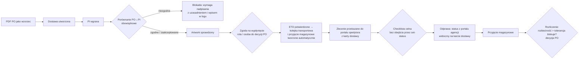
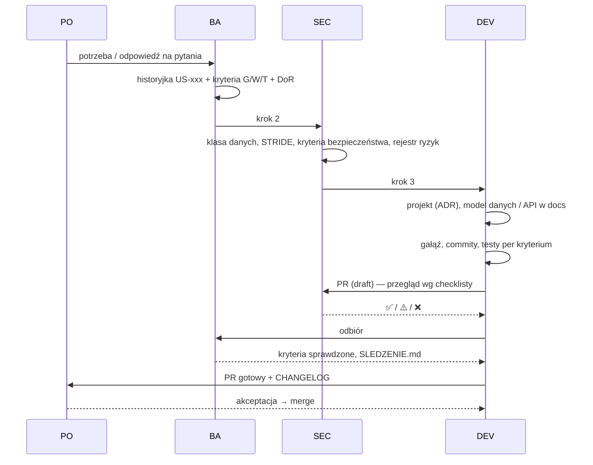

# Procesy: AS-IS i TO-BE

> [BA] Wersja 0.1. Pełny opis kroków, aktorów, punktów decyzyjnych i maszyny stanów: `docs/02-proces.md`
> (sekcje 2–7). Ten dokument streszcza i pokazuje różnicę między stanem obecnym a docelowym.

## 1. AS-IS przed aplikacją (z dokumentów)

Excel na SharePoint jako tablica zleceń, lista ETD z Oddziału Chiny porównywana ręcznie z SAP, zgoda na wypłynięcie
mailowo, krzyżowa kontrola PO↔PI↔CI↔PL↔SAD ręcznie, pliki na dysku `Z:`, numery rozliczeń wklejane ręcznie na PDF,
potwierdzenia na Teams (`docs/01-problem-i-zakres.md` §1.1).

## 2. AS-IS z aplikacją (stan kodu)

```mermaid
flowchart LR
    A[PO w SAP / PDF PO] --> B[Manager zakłada dostawę<br/>/dostawy, status utworzone]
    B --> C[Proforma PI od dostawcy<br/>upload do slotu]
    C --> D{Porównanie PO↔PI<br/>enhanced_comparator}
    D -->|zgodne| E[sprawdzone_zgodne]
    D -->|do weryfikacji| F[sprawdzone_do_weryfikacji]
    D -->|niezgodne| G[sprawdzone_niezgodne<br/>twarda bramka]
    G -->|set-status + notatka| E
    E --> H[Artwork: wzorzec vs fabryczny<br/>EAN / GS1-128]
    H -->|błędne| H1[artwork_bledne<br/>twarda bramka]
    H -->|ok| I[zatwierdzone_do_wyplyniecia]
    I --> J[confirm-departure: ETD<br/>kontener w kolejce transportowej]
    J --> K[Tracking, demurrage,<br/>portal spedytora]
    K --> L[Packing list, CI, B/L, SAD<br/>checklista celna]
    L -->|CI+PL+BL+SAD zatwierdzono| M[dokumenty_wyslane_odprawa<br/>portal agencji: customs_status]
    M --> N[PZC, dostawa do magazynu]
    N --> O[rozliczenie_fiori,<br/>rozliczenie_transportu]
```

Znane obejścia ścieżki głównej (do decyzji PO, pytanie 3): `advance` z `proforma_otrzymana` omija porównanie,
`confirm-departure` przechodzi z `artwork_bledne`, `set-status` omija checklistę celną, `GET /dostawy/<nr>` może
zmienić status (`docs/07-ograniczenia.md` §3, `docs/02-proces.md` §7).

## 3. TO-BE (najbliższy horyzont, zgodny z założeniami Z-01…Z-04)

Różnice względem AS-IS: (1) bramki nieomijalne i audytowane, (2) hooki kolejki transportowej i przyjęcia
magazynowego wołane z każdej ścieżki zmiany statusu, (3) zgoda na wypłynięcie nadawana w systemie,
(4) przekazanie do portali z UI, (5) opcjonalnie bramka rozliczenia. Historyjki: US-008…US-015.

## 4. Proces docelowy z dokumentów (wizja, poza najbliższym horyzontem)

27 kroków z `docs/PROCES_ZAKUPY_FLOW.md` (SAP BW jako źródło prawdy, portal potwierdzeń ETD, alerty, bramka MIR7,
komplety dokumentów) pozostaje wizją do czasu decyzji PO (pytania 1 i 4 w `docs/AUDYT.md` §5).

## 5. Proces pracy zespołu nad zmianą

