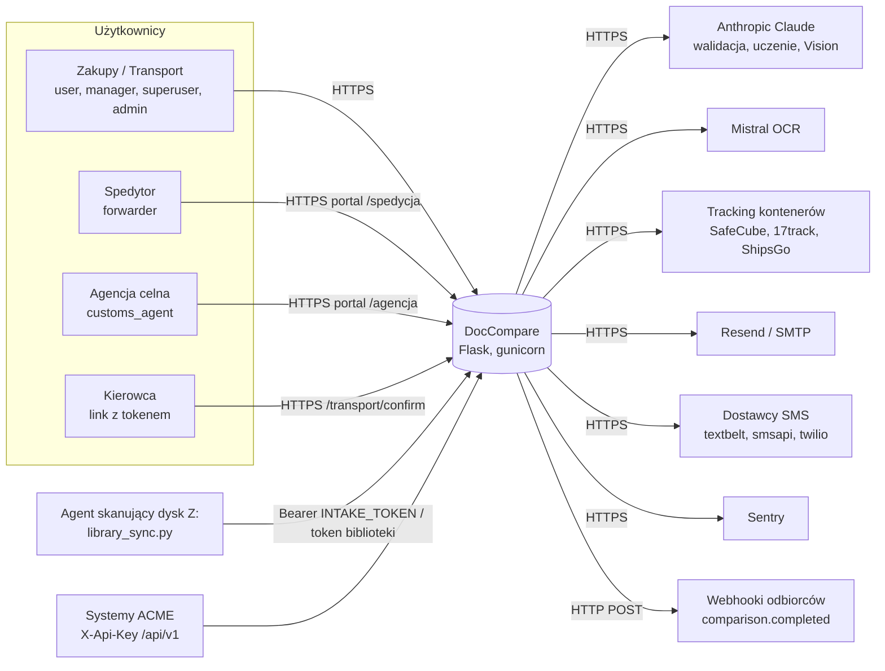
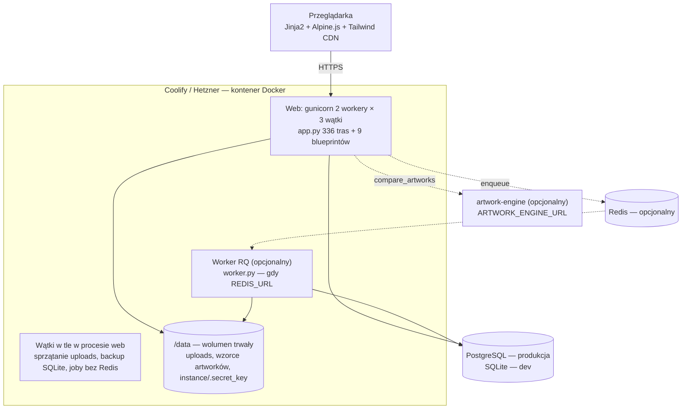

# Architektura (C4: kontekst i kontenery)

> [DEV] Wersja 0.1 (2026-10-16). Uzupełnia `CLAUDE.md` (architektura modułów), `docs/architektura.md` (nawigacja
> po modułach UI), `docs/KOLEJKOWANIE.md` (kolejka RQ), `docs/PLAN_REFAKTORU.md` (roadmapa podziału).

## 1. Kontekst (C4 poziom 1)

Granice zaufania: przeglądarka ↔ aplikacja (sesja + CSRF), aplikacja ↔ integracje (klucze API), role zewnętrzne
zamknięte prefiksami ścieżek, API maszynowe z tokenami stałoczasowo porównywanymi.

## 2. Kontenery (C4 poziom 2)

| Kontener | Technologia | Odpowiedzialność | Uwagi |
|---|---|---|---|
| Web | Flask 3, gunicorn gthread | HTTP, sesje, autoryzacja, porównania, stepper, portale, admin | import `app.py` ma efekty uboczne (`init_db()`, start 2 wątków) — US-020 |
| Worker | RQ | ciężkie zadania (batch artworków) | fallback: wątek-demon w procesie web (D-06) |
| Baza | PostgreSQL / SQLite przez `db.py` | dane biznesowe, `audit_log`, `settings`, `job_progress` | schemat w 3 źródłach — US-018 |
| Wolumen `/data` | dysk | PDF tymczasowe (24 h), wzorce, klucz sesji | poza backupem bazy — `docs/BACKUP_RESTORE.md` |
| artwork-engine | osobny serwis (faza MLSPLIT-02) | odciążenie CV | klient wraca do trybu in-process przy błędzie |

## 3. Komponenty (poziom 3, skrót)

| Pakiet / moduł | Rola |
|---|---|
| `core/` | `security.py` (login_required, require_role, csrf_protect, require_api_key), `audit.py`, `validation.py`, `timeutil.py` — bez zależności od `app` |
| `blueprints/` | `auth`, `suppliers`, `warehouse`, `palviz`, `kolejka`, `api_invoices`, `incoterms`, `transit_countries`, `translation_dict` (zależność dozwolona: blueprint → core/db; wyjątek do usunięcia: `kolejka.py` importuje `app`) |
| Silnik porównań | `table_extractor.py` → `pdf_extractor.py` → `normalizer.py` → `semantic_matcher.py` → `enhanced_comparator.py` → `typo_detector.py` → `ai_validator.py` → `export_engine.py` |
| Proces dostawy | `delivery_workflow.py`, `customs_checklist.py`, `demurrage.py`, `forwarding_order.py`, `warehouse_stock.py` |
| Artwork | `artwork_comparator.py`, `artwork_report_engine.py`, `barcode_validator.py`, `artwork_index.py`, `artwork_3d.py`, `artwork_batch_processor.py` |
| Faktury | `invoice_routes.py`, `invoice_pipeline.py`, `invoice_mapper.py`, `invoice_jobs.py`, `doc_splitter.py`, `sad_draft_export.py` |
| AI | `ai_validator.py`, `ai_learning.py`, `api_usage_tracker.py` |
| Dane | `db.py`, `migrate_db.py`, `material_master.py`, `supplier_master.py`, `supplier_profiles.py`, `uom.py`, `constants.py` |

## 4. Przekroje

- **Uwierzytelnianie i autoryzacja:** sesja Flask (8 h, HttpOnly, SameSite=Strict, Secure), dekoratory per trasa,
  `before_request` dla ról zewnętrznych i działów (`app.py:1444-1495`). Brak globalnej bramki — każda nowa trasa musi
  mieć dekorator (checklista PR).
- **Konfiguracja:** zmienne środowiskowe (`.env.example`); walidator startowy przerywa start w produkcji przy złym
  `SECRET_KEY` (`app.py:309-330`). Część kluczy integracji w tabeli `settings` (R-02).
- **Zadania w tle i stan:** `job_progress`, `async_jobs`, `artwork_batch_jobs`; cache i limity częściowo w pamięci
  procesu (NFR-025).
- **Obserwowalność:** log plikowy (`LOG_DIR`), Sentry opcjonalny, `/health`, `/api/admin/system-status`, koszty AI w `api_usage`.
- **Wdrożenie:** CI zielone na `main` → `deploy.yml` → API Coolify; `Dockerfile` (monolit) lub `Dockerfile.slim`
  na obrazie bazowym ML z GHCR (`docs/OBRAZ_BAZOWY_ML.md`).

## 5. Decyzje

Historyczne decyzje D-01…D-12: `docs/06-decyzje.md`. Nowe decyzje jako ADR w `docs/architektura/adr/`
(pierwsza: `0001-narzedzia-jakosci-i-bramki-ci.md`).
