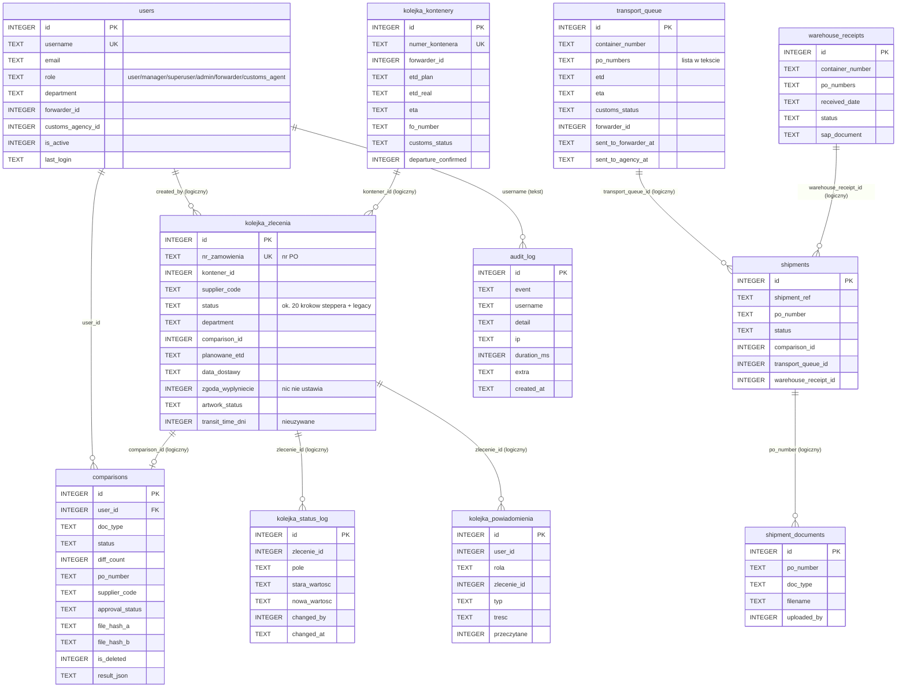

# Model danych (rdzeń)

> [DEV] Wersja 0.1. Pełne diagramy (17 + 21 encji), opis encji i reguły integralności: `docs/04-model-danych.md`.
> Tu: rdzeń potrzebny do zrozumienia procesu oraz lista problemów schematu z audytu.

## 1. ERD rdzenia

Legenda: „logiczny” = powiązanie tylko w kodzie, bez `REFERENCES`. Jedyne zadeklarowane klucze obce w repo (11)
wskazują na `users(id)`; `PRAGMA foreign_keys=ON` działa tylko na SQLite (`db.py:369`).

## 2. Dwa równoległe modele transportu

`kolejka_zlecenia` + `kolejka_kontenery` (stepper dostaw) oraz `transport_queue` + `shipments` + `warehouse_receipts`
(kolejka transportowa używana przez portale) opisują te same fakty (kontener, ETD/ETA, odprawa). Hooki, które miały
je synchronizować, są wołane tylko z `_set_dostawa_status` (US-008). Decyzja, który model jest systemem zapisu,
należy do PO (temat 4 w `docs/AUDYT.md` §2.5).

## 3. Źródła schematu (problem do rozwiązania w US-018)

| Źródło | Co tworzy | Uwagi |
|---|---|---|
| `migrate_db.py` | 34 `CREATE TABLE`, 94 `add_column` | uruchamiany przy starcie kontenera (`Dockerfile:85`) |
| `app.py` (`init_db()` przy imporcie + `_db_run_migrations`) | 47 `CREATE TABLE`, 69 `ALTER TABLE` | 27 tabel istnieje tylko tu (m.in. `audit_log`, `transport_queue`, `shipments`, `webhooks`, `password_reset_tokens`) |
| moduły domenowe | 10 plików z własnym `CREATE TABLE IF NOT EXISTS` | `supplier_profiles.py`, `material_master.py`, `artwork_index.py`, `uom.py`, `invoice_jobs.py`, `warehouse_stock.py`, `blueprints/incoterms.py`, `palviz.py`, `transit_countries.py` |

Wspólnych tabel między `app.py` a `migrate_db.py` jest 19; `users` jest zdefiniowane dwa razy. Zmiany modelu danych
opisujemy najpierw tutaj (sekcja 1 lub `docs/04-model-danych.md`), potem w `migrate_db.py` jako idempotentną migrację.

## 4. Klasy danych w modelu

Dane osobowe: `users` (e-mail, nazwa), `audit_log` (nazwa użytkownika, IP), `drivers` (imię, telefon),
`zlecenia_transportowe` (e-maile, telefon agenta). Poufne handlowo: `comparisons.result_json` (ceny, warunki),
profile dostawców, `material_master`. Szczegóły i retencja: `docs/bezpieczenstwo/KLASYFIKACJA_DANYCH.md`.
