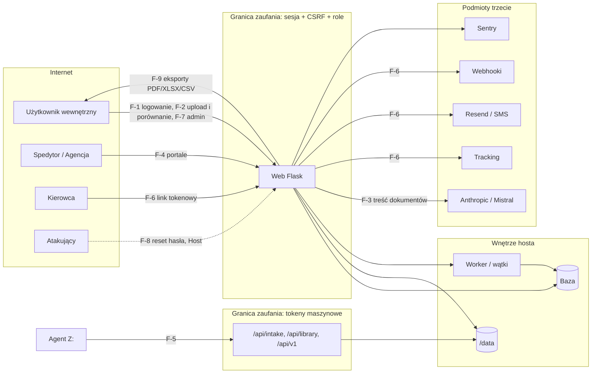

# Threat model (STRIDE) — wersja 0.1

> [SEC] 2026-10-16, stan kodu `ef950bb` + PR #11. Metoda: diagram przepływu danych z granicami zaufania, potem
> STRIDE per przepływ: zagrożenie → istniejąca kontrola → luka → historyjka. Każda nowa funkcja z nowym przepływem
> dodaje tu wiersz (krok 2 procesu). Oznaczenia luk: 🟠 wysokie, 🟡 średnie, ⚪ niskie, ✅ bez luki.

## 1. Diagram przepływu danych

## 2. Aktywa

Dane poufne handlowo (ceny, warunki, profile dostawców, artworki), dane osobowe (użytkownicy, kierowcy, kontakty),
integralność statusów dostawy (bramki), sekrety integracji, dostępność aplikacji (2 workery), reputacja repo publicznego.

## 3. STRIDE per przepływ

### F-1 Logowanie i sesja (`blueprints/auth.py`, `core/security.py`)

| Zagrożenie | Kontrola | Luka | Historyjka |
|---|---|---|---|
| S: zgadywanie haseł | limit 5/15 min/IP w `audit_log`, atrapa hasha (timing), hasło ≥ 8 | brak 2FA dla adminów (SEC-004) ⚪ decyzja PO | — |
| S: kradzież sesji | HttpOnly, SameSite=Strict, Secure, 8 h, `session.clear()` przy logowaniu, dezaktywacja odcina sesję | rola/dział w sesji do wylogowania ⚪ (akceptowane) | E-06 |
| T: podrobienie ciasteczka | `SECRET_KEY` z env/pliku 0600, twardy stop w prod przy złym kluczu | „prod” = tylko `DATABASE_URL` ⚪ | — |
| R: brak śladu | `audit_log` login/logout/login_fail | brak retencji i odporności na manipulację 🟡 | US-007 |
| I: enumeracja kont | ten sam komunikat i czas dla nieistniejących kont | — ✅ | — |
| D: blokada konta cudzymi próbami | limit per IP, nie per konto | limit per IP można obejść rotacją IP ⚪ (akceptowane) | — |
| E: podniesienie roli | `ROLE_LEVEL`, role zewnętrzne poziom 0 | — ✅ | — |

### F-2 Upload PDF i porównanie (`/api/compare`, `/api/dostawy/*`, `table_extractor`)

| Zagrożenie | Kontrola | Luka | Historyjka |
|---|---|---|---|
| T: złośliwy PDF | magic `%PDF`, bez `/Encrypt`, 200 MB, ZIP 20×100 MB, `secure_filename` | walidator nie we wszystkich 49 miejscach `.save(` 🟡 | US-006 (zakres), checklista PR |
| T: zmiana cudzego porównania | `user_id`/`is_public`/`can_see_all` po pobraniu; bramka działu `before_request` | — ✅ (12 tras sprawdzonych) | — |
| I: eksfiltracja przez wynik | wyniki per autor/dział | KPI były globalne — naprawione ✅ | — |
| D: wyczerpanie workerów (2×3) | limit 30/60 s na 12 trasach, `_HEAVY_SEM(3)`, timeout gunicorn 300 s | 22 ciężkie trasy bez limitu 🟡; semafor per proces ⚪ | US-006, US-020 |
| T: path traversal przy pobieraniu | `send_from_directory` + prefiks `{uid}_`, `safe_join` | — ✅ po merge (podgląd PalViz przez `_serve` z prefiksem uid, PR #11) | US-027 |

### F-3 Wywołania AI i OCR (`ai_validator`, `ai_learning`, `table_extractor`, `artwork_comparator`)

| Zagrożenie | Kontrola | Luka | Historyjka |
|---|---|---|---|
| T: prompt injection z treści PDF | `core.prompt_safety` w obu modułach: sanityzacja, blok `<dane_niezaufane>`, reguła systemowa; AI może tylko podnieść ryzyko; sugestie czekają na managera (PR #11) | szczątkowe: model może zignorować regułę ⚪ | US-026 |
| I: wyciek danych poufnych do dostawcy modelu | tryb bez kluczy; brak PII w promptach (zamierzenie) | brak formalnej umowy/minimalizacji w docs 🟡 | RODO.md, Z-07 |
| D/koszt: nieograniczone wywołania | budżet miesięczny, `record_usage` | bramka budżetu tylko w 2 modułach; `table_extractor`/`scan_extractor` nie rejestrują 🟡 | US-006 |
| T: wynik modelu w SQL/ścieżkach | wynik parsowany jako JSON, brak użycia w SQL/FS | — ✅ | — |
| I: prefiks klucza w `/api/ai/status` | odpowiedź tylko `api_key_set` + model (PR #11) | — ✅ po merge | US-027 |

### F-4 Portale zewnętrzne (`/spedycja`, `/agencja`)

| Zagrożenie | Kontrola | Luka | Historyjka |
|---|---|---|---|
| E: spedytor w panelu wewnętrznym | `before_request` z prefiksami, poziom 0 w `require_role`, fail-closed na `//`, wielkość liter, `..` | prefiks dopuściłby przyszłe `/spedycja-*` ⚪ | — (zasada w API.md) |
| I: cudze zlecenia | filtr `forwarder_id` / `customs_agency_id` | `api_spedycja_update` akceptuje każdą rolę zewnętrzną (D-10) ⚪ decyzja | — |
| T: zmiana statusu poza listą | lista 5 wartości, 400 | — ✅ | — |
| R: kto zmienił status odprawy | `audit_log` | — ✅ | — |

### F-5 API maszynowe (`/api/intake/artwork`, `/api/library/*`, `/api/v1/*`)

| Zagrożenie | Kontrola | Luka | Historyjka |
|---|---|---|---|
| S: zgadywanie tokenu | `hmac.compare_digest`, 503 gdy brak tokenu | brak limitu prób ⚪; brak rotacji w runbooku → dodane | US-006 |
| T: zapis poza katalogiem | `realpath` + prefiks, `secure_filename`, magic bytes | — ✅ | — |
| R: brak śladu | `audit_log` dla intake/sync | do sprawdzenia per endpoint ⚪ | US-023 |

### F-6 Kanały wychodzące (webhooki, e-mail, SMS, tracking) i link kierowcy

| Zagrożenie | Kontrola | Luka | Historyjka |
|---|---|---|---|
| SSRF przez webhook | tylko admin; `_is_ssrf_blocked_url` (DNS → prywatne/loopback/link-local) | TOCTOU/DNS rebinding, przekierowania, brak listy portów ⚪ | US-027 |
| I: token SMSAPI w URL | — | token w query stringu → logi proxy 🟡 | US-002 |
| S: podrobienie potwierdzenia kierowcy | token `token_urlsafe(24)`, wygasa ze statusem | ekran pokazuje „Potwierdzono!” mimo błędu serwera ⚪ (UX) | US-023 |
| I: treść dokumentów w e-mailach | — | do potwierdzenia, czy PO do dostawcy zawiera załączniki | RODO.md |

### F-7 Panel administracyjny i sekrety (`/admin`, `/settings/*`)

| Zagrożenie | Kontrola | Luka | Historyjka |
|---|---|---|---|
| I: odczyt kluczy z bazy/backupu | — | klucze API/SMS/Anthropic jawnym tekstem w `settings` 🟡 | US-002 |
| E: manager zapisuje klucze | `require_role("manager")` | zapis sekretów powinien być tylko dla admina 🟡 | US-002 |
| E: `require_role` jako wartość logiczna | dekorator `@require_role("manager")` + strażnik AST w testach (PR #11) | — ✅ po merge | US-001 |
| T: usunięcie ostatniego admina | blokada | — ✅ | — |
| R: zmiany konfiguracji bez śladu | `audit_log` w części tras | przegląd per trasa ⚪ | US-023 |

### F-8 Reset hasła

| Zagrożenie | Kontrola | Luka | Historyjka |
|---|---|---|---|
| S: zatrucie nagłówka Host → link do obcej domeny | `APP_BASE_URL` jeśli ustawione | fallback do `request.host_url` za `ProxyFix(x_host)` 🟡 | US-003 |
| S: ponowne użycie tokenu | atomowe `UPDATE … WHERE used=0`, 24 h, unieważnianie starych | — ✅ | — |
| D: bombardowanie e-mailami | 3/15 min/IP i 3/15 min/konto | — ✅ | — |

### F-9 Raporty i eksporty (PDF, XLSX, CSV, raport artworku)

| Zagrożenie | Kontrola | Luka | Historyjka |
|---|---|---|---|
| E: dostęp do cudzego raportu artworku | `_artwork_access_allowed()` fail-closed we wszystkich odczytach po `cache_id` (PR #11) | — ✅ po merge | US-004 |
| T: formula injection | XLSX i CSV: wspólny `formula_safe` (prefiks `'` dla `= + - @ \t \r`) | — ✅ po merge | US-027 |
| I: traceback w odpowiedzi | generyczny handler 500; PalViz zwraca identyfikator błędu, szczegóły w logu (PR #11) | — ✅ po merge | US-027 |
| T: XSS w raporcie HTML | 0 `\|safe`, `escHtml` | CSP `unsafe-inline`/`unsafe-eval`, 244 `innerHTML`, `escHtml` bez cudzysłowów 🟡 | US-025 |

## 4. Podsumowanie luk

| Waga | Liczba | Historyjki |
|---|---|---|
| 🟠 | 0 (1 naprawione w PR #11, zamknięcie po merge) | US-001 |
| 🟡 | 11 | US-002, US-003, US-004, US-006, US-007, US-025, US-026 |
| ⚪ | 13 | US-027, US-023, US-020, decyzje PO |

Następny przegląd: po scaleniu Sprintu 1 lub przy pierwszym nowym przepływie danych.
